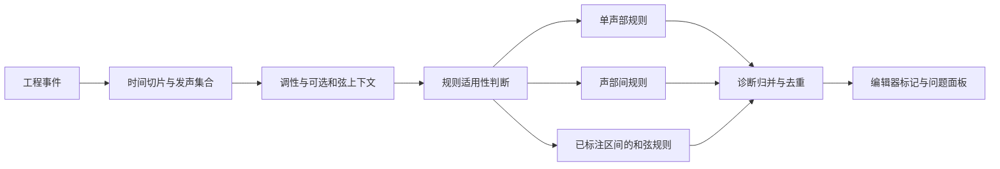
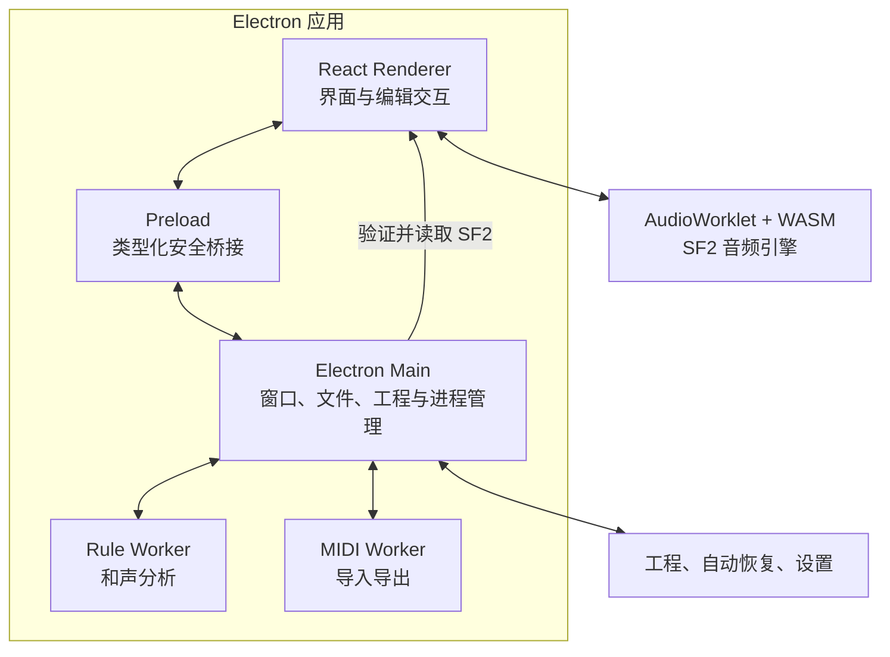

# SATB Master 产品与技术设计文档

> 文档状态：Draft v0.2  
> 更新日期：2026-07-25  
> 产品形态：离线优先的桌面端四部和声练习软件  
> 当前范围：仅实施 P0  
> 当前技术底座：React + Electron + TypeScript + Vite

## 1. 文档目的

本文档用于统一 SATB Master 的产品范围、交互模型、领域模型、技术架构和分阶段交付标准，并作为后续需求拆分、原型设计、编码和测试的依据。

当前建议不是一次性实现完整 DAW，而是先建立一个围绕“四部写作 -> 即时检查 -> 回放 -> 修正 -> 导出”的可靠练习闭环，再逐步扩展音源宿主和教学能力。

## 2. 产品定义

### 2.1 一句话定位

SATB Master 是一款面向和声学习者与教师的桌面写作工具，用户可以在四声部钢琴卷帘中完成和声练习，获得可解释、可定位、可配置的规则反馈，并通过音色回放与 MIDI 导出验证结果。

### 2.2 核心价值

1. 比纸笔更容易编辑和试听四声部。
2. 比通用 DAW 更理解“声部、和弦、调性和和声规则”。
3. 比只给对错的题库更重视规则解释和错误定位。
4. 保留开放的音频与 MIDI 工作流，不把用户锁在单一音色或文件格式中。

### 2.3 目标用户

| 用户 | 主要需求 | 产品侧重点 |
| --- | --- | --- |
| 和声初学者 | 完成作业、理解错误、听辨声部进行 | 明确提示、基础规则配置、简单音色 |
| 中高级学习者 | 严格写作、快速编辑、比较多种解决方案 | 高效编辑、细粒度规则、版本快照 |
| 教师 | 布置限制条件、演示错误、查看学生结果 | 给定声部、锁定范围、本地工程文件 |
| 编曲或作曲学习者 | 将草稿转入 DAW 继续制作 | 稳定 MIDI 导出、SF2 回放 |

### 2.4 产品原则

- **音乐语义优先**：界面与数据模型围绕声部、调性、和弦和拍位，而不是通用音频片段。
- **提示而非强行代写**：规则检查器解释问题并给出方向，不默认替用户完成答案。
- **非破坏性编辑**：所有编辑可撤销；规则检查不修改原始音符。
- **离线优先**：工程、音源配置和分析均可在本机完成。
- **确定性优先**：相同工程、相同规则配置应产生相同诊断结果。
- **故障隔离**：SF2 引擎或音频设备异常不能导致工程数据丢失。

### 2.5 当前非目标

以下内容不进入首个可用版本：

- 完整五线谱排版与出版级制谱。
- 多人实时协作、云同步和账户系统。
- 音频录音、波形编辑和完整混音母带功能。
- 自动生成整份标准答案。
- 移动端、浏览器端和触屏优先交互。
- macOS 和 Linux 版本。
- MIDI 键盘输入、步进录入和实时录入。
- VST3 宿主、VST 音频效果器链、复杂自动化和采样器编辑。
- 自动和弦推断、MusicXML 和五线谱视图。
- 教师账户、在线题库、云端批改和报告系统。
- Jazz、流行、无调性等全部理论体系同时覆盖。

首期规则体系以国内常用的《和声学教程》（斯波索宾等著，以下称“斯波索宾体系”）为基准，聚焦传统大小调功能和声。具体规则用语和例题应以项目最终选定的中文版本为校对依据。

## 3. 核心使用闭环

### 3.1 自由写作

1. 新建工程，选择初始调号、拍号、速度和小节数，并可在时间轴中添加变化事件。
2. 在 Soprano、Alto、Tenor、Bass 四条音轨中输入音符。
3. 按需要在和弦轨输入罗马数字或绝对和弦符号；和弦轨允许完全留空。
4. 软件增量执行规则检查，在音符和时间轴上标出问题。
5. 用户查看解释、试听局部、修改并再次检查。
6. 保存工程或导出标准 MIDI 文件。

### 3.2 约束练习

1. 打开含给定材料的本地练习工程，如“给定低音配四部”“给定旋律配和声”“给定和弦连接”。
2. 工程锁定给定声部、和弦或时间区间，并声明允许编辑的范围。
3. 用户完成其余内容。
4. 规则面板按练习目标显示结果，可选择隐藏部分提示。
5. 用户完成前执行一次完整检查并保存或导出结果。

P0 支持锁定完整声部、单个事件和时间区间，但不建设教师账户、题库或在线提交系统。练习通过普通 `.satb` 工程文件分发。

### 3.3 错误复盘

1. 从问题面板选择一条诊断。
2. 编辑器定位并高亮相关音符、声部与拍位。
3. 面板显示规则名称、触发原因、上下文和建议方向。
4. 用户可循环试听问题前后一至两拍。
5. 修正后，该诊断消失或更新，历史修改可撤销。

## 4. P0 版本范围

### 4.1 P0：首个可用版本

- 新建、打开、保存、另存为和自动恢复工程。
- 四条固定语义声部轨与一条可选和弦轨；和弦轨可以留空。
- 可缩放、可滚动的钢琴卷帘和完整基础编辑。
- 选择、绘制、移动、缩放、复制、粘贴、删除、量化、移调、撤销和重做。
- 时间轴上的调号、拍号和速度变化，以及小节线、拍线、吸附和循环区间。
- 完整声部、事件和时间区间的锁定，用于给定低音或给定旋律练习。
- 内置轻量回放音色，保证无外部音源时仍可试听。
- 随软件附带一个许可允许再分发的默认 SF2，同时允许加载用户本地 SF2。
- SF2 预设选择和四声部独立音量/声像。
- 以斯波索宾体系为基准的首组规则及问题面板。
- Standard MIDI File Type 1 导出；非空和弦轨默认写入独立 `Chords` 轨。
- 仅发布简体中文 Windows 10/11 x64 桌面版。

### 4.2 明确不在 P0 范围内

- VST3 插件扫描、宿主、插件窗口和插件状态保存。
- MIDI 键盘输入、实时录入和步进录入。
- 自动和弦推断和自动改写建议。
- macOS、Linux、移动端和浏览器端。
- MusicXML、五线谱、音频录制和离线音频渲染。
- 教师账户、在线题库、云同步、在线提交和批改。
- 斯波索宾体系之外的规则包。

这些能力不进入当前实施路线，也不为其创建空模块。领域模型只保留成本很低且不会增加 P0 复杂度的扩展点。

### 4.3 P0 完成定义

P0 必须完成以下闭环：创建或打开四部练习、编辑未锁定内容、按需填写和弦、获得斯波索宾体系的基础规则反馈、使用默认 SF2 稳定回放、保存并重新打开、导出 MIDI。

和弦轨为空、用户未安装任何音源、音频设备暂时不可用时，工程仍必须可以编辑、检查、保存和导出 MIDI。

## 5. 桌面端信息架构

### 5.1 主窗口布局

```text
+--------------------------------------------------------------------------------+
| 菜单 / 工程名                 传输控制、速度、循环、音频状态                 |
+------------+---------------------------------------------------+---------------+
| 轨道头     | 时间标尺、和弦轨                                  | 属性检查器    |
| Soprano    +---------------------------------------------------+               |
| Alto       |                                                   | 选中音符      |
| Tenor      |                  钢琴卷帘                         | 和弦属性      |
| Bass       |                                                   | 工程设置      |
|            |                                                   |               |
+------------+---------------------------------------------------+---------------+
| 问题 / 混音 / 音源 / 练习要求                                                |
+--------------------------------------------------------------------------------+
```

布局原则：

- 中央编辑区始终占据最大面积，不使用卡片式分割。
- 四个声部共享一个钢琴卷帘，避免用户在多个窗口间比对纵向音程。
- 轨道头固定在左侧，水平滚动只影响时间轴。
- 钢琴键盘和音高标尺固定在编辑区左缘，垂直滚动与卷帘同步。
- 下方面板可折叠，问题面板默认优先于混音面板。
- 属性检查器根据选择上下文切换，不显示无关设置。

### 5.2 顶部传输区域

需要包含：

- 回到开头、播放/暂停、停止。
- 当前播放位置，小节:拍:tick。
- 速度输入与节拍器开关。
- 循环开关和循环范围。
- 全部声部试听、仅当前声部试听。
- 音频设备/引擎状态指示。
- 未保存状态。

### 5.3 轨道头

每条声部轨固定显示：

- 声部名称和颜色标识，同时使用文字或字母避免只依赖颜色。
- 静音、独奏、锁定、显示/隐藏。
- 音量和声像的紧凑入口。
- 音域状态：正常、接近边界、超出建议音域。
- 当前音源/预设名称。

和弦轨不进入音频混音，不具有静音和独奏，只提供显示、锁定与分析模式。

### 5.4 底部面板

底部使用标签页承载以下视图：

- **问题**：诊断列表、严重度、位置、规则名称和筛选器。
- **混音**：四声部音量、声像、静音、独奏和主输出。
- **音源**：内置回退音色、默认 SF2、用户 SF2 及预设管理。
- **练习要求**：题目说明、给定条件、完成度和检查范围。

## 6. 功能规格

### 6.1 工程与时间结构

每个工程至少包含：

- 标题、作者、备注、创建时间和修改时间。
- PPQ 时间基准，建议内部固定为 960 ticks/quarter note。
- 调性事件、拍号事件和速度事件。
- 四条声部轨、一条和弦轨和练习约束。
- 音源路由、混音参数和规则配置。
- 编辑器视图状态，例如缩放、滚动、当前工具和面板布局。

P0 直接支持调号、拍号和速度的时间轴变化事件。事件默认吸附到小节起点；速度事件可落在任意拍位。变拍号后的小节编号和 MIDI 导出必须使用同一 tempo/meter map 计算。

### 6.2 钢琴卷帘编辑器

#### 6.2.1 显示

- 横轴为音乐时间，纵轴为 MIDI 音高。
- 小节线、拍线、细分网格使用不同视觉权重。
- 四个声部使用稳定且可辨认的颜色，并在音符上提供 S/A/T/B 标识选项。
- 音符显示起点、长度、选中态、锁定态、静音态和诊断状态。
- 播放头、编辑光标、循环范围和当前和弦区域不能互相混淆。
- 可选显示和弦音、非和弦音、共同音和倾向音的语义标记。

#### 6.2.2 工具与操作

- **选择工具**：单选、框选、追加选择、按声部选择、按小节选择。
- **铅笔工具**：单击创建默认时值，拖动创建指定时值。
- **擦除工具**：点击或拖过删除，整个动作只形成一个撤销步骤。
- **切分工具**：在吸附点拆分音符。
- **缩放工具**：滚轮、快捷键和时间/音高方向独立缩放。
- 拖动音符可同时改变起点和音高；按修饰键限制为单一方向。
- 拖动左右边缘改变时值；最短时值由当前网格设置决定。
- 复制、剪切、粘贴时保留声部和相对时间间隔。
- 支持八度移调、半音移调、全音阶移调和量化。
- 支持将选中音符对齐、连奏化和统一时值。

#### 6.2.3 吸附与时间

- 网格至少支持全音符至三十二分音符、附点和三连音。
- 视觉网格与编辑吸附可以独立开关。
- 支持相对吸附：移动一组音符时保持组内微小时差。
- 所有时间运算使用整数 tick，禁止用浮点秒数保存编辑结果。
- 秒数只在播放调度时由 tempo map 转换。

#### 6.2.4 单声部约束

同一声部原则上不允许音符重叠。发生碰撞时，编辑器应在提交前显示结果预览，并允许：

- 修剪相邻音符至边界。
- 替换碰撞区间内的旧音符。
- 取消操作。

禁止静默删除音符。所有碰撞处理必须是一个可撤销命令。

#### 6.2.5 输入方式

- 鼠标和键盘必须覆盖全部核心编辑操作。
- 电脑键盘可用于上下移动音高、左右移动时间、调整时值和声部。
- 键盘输入预听需要经过节流，避免快速移动时产生音频堆积。
- P0 不接入外部 MIDI 键盘，也不为实时录入维护隐藏入口或未完成配置。

### 6.3 四条声部轨

声部固定为 Soprano、Alto、Tenor、Bass，但音域规则可以按规则配置调整。

建议默认参考音域，内部以 MIDI note number 为准：

| 声部 | 建议范围 | 说明 |
| --- | --- | --- |
| Soprano | C4-A5 | MIDI 60-81 |
| Alto | G3-D5 | MIDI 55-74 |
| Tenor | C3-G4 | MIDI 48-67 |
| Bass | E2-C4 | MIDI 40-60 |

不同软件对中央 C 的八度编号可能不同。界面可选择显示习惯，但工程数据只保存 MIDI note number，避免歧义。

每个声部具有：

- 独立音符集合。
- 固定的语义身份，不能通过拖动轨道顺序改变其规则含义。
- 音量、声像、静音、独奏和音源路由。
- 建议音域与绝对可输入范围。
- 锁定状态及练习模板中的可编辑区间。

### 6.4 和弦轨

和弦轨不是普通文本标记集合，而是结构化和声事件。

#### 6.4.1 显示模式

- 罗马数字：`I`、`ii6`、`V7/V` 等。
- 绝对和弦：`C`、`Dm/F`、`G7` 等。
- 双行显示：上方罗马数字，下方绝对和弦。

#### 6.4.2 编辑能力

- 创建、移动、调整长度、复制和删除和弦区域。
- 从和弦面板选择级数、变化音、性质、转位和副属目标。
- 锁定给定和弦，防止练习过程中误改。
- 允许“未知/待分析”区域，不强迫所有时刻都有确定和弦。
- 允许一个和弦跨越多个拍，或在一拍内出现多个和弦。

#### 6.4.3 和弦轨可选行为

P0 不提供自动和弦推断。规则检查器根据和弦轨状态分层工作：

1. 和弦轨为空时，执行音域、间距、交叉、重叠、旋律进行和平行完全协和音程等不依赖和弦标签的规则。
2. 和弦轨部分填写时，只在已填写区间执行和弦构成、转位、重复音和功能连接规则。
3. 和弦轨完整填写时，执行 P0 全部适用规则。
4. 因缺少和弦信息而跳过的规则在检查摘要中列出，但不生成大量逐拍警告。

软件不得为了执行功能规则而静默创建或保存推断和弦。

### 6.5 播放与传输

- 支持从播放头开始、从选择开始、循环选择和仅试听当前和弦。
- 停止后再次播放的行为可设置为“返回开始点”或“停在当前位置”。
- 速度范围建议为 20-300 BPM。
- 节拍器可以单独调节音量和预备拍。
- 编辑时允许不中断播放，但影响未来时间片的改动需要安全更新调度队列。
- 播放头动画来自音频时钟映射，不以 UI 定时器作为真实播放时钟。
- 音频设备断开时停止播放、保留位置并提供可恢复状态。

### 6.6 音源系统

#### 6.6.1 统一音源抽象

每条声部轨连接一个 `InstrumentSlot`，其实现可以是：

- `builtin`：内置轻量合成音色，始终可用。
- `sf2`：SoundFont 音色和预设。

编辑器、播放调度器和工程模型只依赖统一抽象，不直接依赖具体 SF2 API。

#### 6.6.2 SF2

SF2 是 P0 唯一外部音色方案：

- 安装包附带一个体积可控、许可允许再分发的默认 SF2，并记录来源、版本和许可证文本。
- 首次启动即可使用默认 SF2，不要求用户下载或选择文件。
- 支持加载本地 `.sf2` 文件。
- 显示 bank、program 和预设名称。
- 四声部可使用同一 SoundFont 的不同预设，也可共享一个合唱类预设。
- 工程默认只保存文件引用、文件摘要和预设信息，不把大型 SF2 嵌入工程。
- 文件移动或缺失时进入“需要重新定位”状态，不阻止工程打开。
- 必须保留内置音色回退，防止无 SF2 时无法播放。

默认 SF2 的具体选型在实现音频阶段确定，选择顺序为：可再分发许可证明确、Windows 上稳定、体积适合随安装包分发、基础钢琴或合唱音色可辨识、无需联网激活。

#### 6.6.3 P0 SF2 播放实现

P0 优先采用 Web Audio `AudioWorklet + WASM SoundFont` 方案，避免引入 C++ 编译、独立进程协议和额外签名流程。合成工作运行在 AudioWorklet 音频线程，不运行在 React UI 线程。

P0 需要定义稳定的 `Sf2Engine` 接口，覆盖：

- 默认 SF2 与用户 SF2 的异步加载。
- 四个 MIDI channel 的预设、音量和声像。
- note-on、note-off、播放、停止、seek、循环和全音符关闭。
- 播放时钟、主输出电平、AudioContext suspend/resume 和错误状态。
- 音频设备由 Chromium/Web Audio 管理；P0 不提供复杂的 ASIO 或独占设备设置。

Main 负责验证并读取默认或用户 SF2，Renderer 将数据一次性转交给音频引擎。不得在每次发音时通过 Electron IPC 往返。

进入 Phase 2 时先做短周期技术验证。若 AudioWorklet/WASM 在 Windows 10/11 上无法满足启动、内存、稳定性或延迟目标，再单独评审最小原生辅助进程；在验证失败前不创建原生宿主项目。

若未来重新评估 VST3，默认采用“每个声部一个独立乐器实例”，因为它不要求第三方插件支持多音色模式。该决定不产生任何 P0 实现任务。

### 6.7 混音

P0 只提供练习所需的最小混音能力：

- 四声部音量、声像、静音和独奏。
- 主输出音量和削波指示。
- 声部均衡预设不进入 P0。
- 默认声像应较窄，避免把和声关系过度空间化。
- 所有参数变化需要平滑处理，避免 zipper noise。

### 6.8 MIDI 导出

默认导出 Standard MIDI File Type 1：

- Track 0：tempo、time signature、key signature、marker 等全局事件。
- Track 1-4：Soprano、Alto、Tenor、Bass，默认 MIDI channel 1-4。
- 和弦轨非空时默认创建 Track 5 `Chords`，每个和弦使用 Marker meta event 写入；导出对话框允许关闭该轨。
- 保留音符起点、时值、力度和轨道名称。
- 导出前检查非法负时间、零时值、越界音高和声部重叠。
- 若使用 SF2 且存在明确 GM 映射，可写入 bank/program。
- 提供“从第 1 小节开始”和“仅导出选区”选项。
- MIDI 导出不依赖当前音频设备或插件是否可用。

### 6.9 工程恢复与异常状态

- 自动保存使用独立恢复文件，不覆盖用户最近一次显式保存。
- 建议在编辑停止 5 秒后尝试恢复保存，并设置最长 30 秒间隔。
- 显式保存采用临时文件写入后原子替换，避免半写文件。
- 启动时发现异常退出的恢复文件，应显示修改时间和原工程位置。
- SF2 或音频设备不可用时，工程仍可进入只编辑状态。
- 工程格式升级必须通过版本化迁移，禁止直接假设旧字段存在。

## 7. 和声规则检查器

### 7.1 设计目标

规则检查器必须同时满足：

- **可定位**：指出具体小节、拍位、声部和音符。
- **可解释**：说明触发条件，而不是只显示“错误”。
- **可配置**：不同教材和教师可调整严重度或关闭规则。
- **可增量**：局部编辑后只重算受影响窗口。
- **可测试**：每条规则是确定性的纯逻辑，拥有正例和反例。
- **不过度承诺**：存在上下文歧义时显示置信度或“需要人工判断”。

### 7.2 严重度

| 等级 | 含义 | 默认表现 |
| --- | --- | --- |
| Error | 明确违反当前规则配置 | 红色定位，计入未通过 |
| Warning | 教材常规上不建议，或依赖上下文 | 黄色定位，不阻止完成 |
| Suggestion | 写作风格、可唱性或改进方向 | 中性提示，可整体隐藏 |
| Info | 分析结果，例如非和弦音分类 | 只在分析层显示 |

严重度属于规则配置，而不是硬编码在 UI 中。

当前实现在“设置 > 检查规则”中列出所有已接入的规则，可选“错误、警告、建议、无”。“无”表示关闭该规则，不生成诊断，也不计入因缺少和弦上下文而跳过的规则数。规则配置属于应用级本机偏好，不写入 `.satb` 工程。`Info` 仍作为未来分析型规则的预留等级，当前诊断尚未使用。

### 7.3 斯波索宾 P0 规则集合

规则名称、例外条件、严重度和解释文字以国内常用《和声学教程》（斯波索宾等著）的中文教学体系为基准。实现前需确定用于校对的具体版次，并把每条规则关联到章节、页码或人工确认的例题编号；代码中的 `ruleId` 保持稳定，不直接使用页码作为标识。

#### 7.3.1 声部与音域

- 每个声部超出建议音域。
- 相邻上三声部间距超过八度，Bass-Tenor 间距单独配置。
- 声部交叉。
- 前一时刻的声部重叠。
- 同一声部音符重叠或同一时刻出现多个音高。

#### 7.3.2 旋律进行

- 增音程、减音程或过大跳进。
- 连续同方向跳进导致可唱性下降。
- 大跳后未按规则配置反向回补。
- 导音未解决到主音。
- 和弦七音未按配置下行解决。
- 旋律增二度等风格限制。

#### 7.3.3 声部间进行

- 平行纯五度。
- 平行八度或同度。
- 反向或同向进入的隐藏五度、隐藏八度，优先检查外声部。
- 不必要的声部交叉或重叠。
- 可配置检查重复音造成的连续完全协和关系。

#### 7.3.4 和弦构成与重复

- 和弦缺少关键构成音。
- 三和弦与七和弦的音数不符合当前上下文。
- 重复导音。
- 不恰当的和弦七音重复。
- 转位与低音不一致。
- 终止四六、经过四六、辅助四六的上下文提示。
- 主属功能的基础连接错误。

### 7.4 分析流水线



推荐步骤：

1. 按所有 note-on、note-off、和弦、调号和拍位边界建立时间切片。
2. 计算每个切片的四声部快照、持续音和新起音。
3. 读取用户填写或练习给定的和弦；无和弦区间不生成推断结果。
4. 根据和弦信息是否存在，判断每条规则在当前切片是否适用。
5. 执行只依赖一个声部的规则。
6. 执行依赖相邻时间片和多个声部的规则。
7. 执行依赖功能与语法的规则。
8. 归并同一根因产生的重复诊断，并保留关联规则。

### 7.5 规则接口

规则实现应遵循统一接口，以下为概念模型而非最终代码：

```ts
interface HarmonyRule {
  id: string
  category: RuleCategory
  defaultSeverity: Severity
  dependency: RuleDependency
  evaluate(context: RuleContext, config: RuleConfig): Diagnostic[]
}

interface Diagnostic {
  id: string
  ruleId: string
  severity: 'error' | 'warning' | 'suggestion' | 'info'
  fromTick: number
  toTick: number
  trackIds: VoiceTrackId[]
  noteIds: string[]
  messageKey: string
  messageParams: Record<string, string | number>
  explanationKey: string
  confidence: number
}
```

消息使用 `messageKey + params`，规则逻辑不直接拼接界面文字。P0 只提供简体中文资源，但仍保持规则计算与中文术语分离，便于统一修改解释文字。

### 7.6 增量检查

每个规则声明自身依赖范围，例如：

- 当前音符。
- 同一时间切片。
- 前后一个和弦切片。
- 当前小节或当前乐句。
- 全曲。

编辑命令产生 `ChangeSet`，包含变化的声部、tick 范围和事件类型。检查器据此只失效相关缓存。全曲检查仍作为保存前和导出前的最终校验。

### 7.7 建议与自动修复边界

P0 不提供一键自动改写。诊断可提供结构化建议，例如：

- “尝试让 Alto 保持共同音”。
- “将 Soprano 改为级进解决至主音”。
- “当前转位通常不重复导音”。

P0 不生成替代音符、不提供一键修复，也不创建候选和弦。

## 8. 技术架构

### 8.1 总体边界



### 8.2 Renderer 职责

- React 视图、工作区布局和可访问性。
- 钢琴卷帘绘制、命中测试、选择和拖拽预览。
- 编辑命令构造、撤销/重做和本地视图状态。
- 诊断显示和问题导航。
- 不直接访问 Node.js 文件系统或原生插件。
- 不在 UI 线程执行全曲规则分析或 MIDI 编码。

钢琴卷帘建议采用 Canvas 或 WebGL 绘制主要网格和音符，DOM 用于工具栏、轨道头、菜单、属性和可访问性代理。不要为每个音符创建复杂 React 组件，否则缩放和滚动时容易产生性能问题。

### 8.3 Preload 职责

- 只暴露白名单 API，例如 `project.open()`、`project.save()`、`audio.play()`、`midi.export()`。
- 每个 API 使用明确的参数和返回类型。
- 不向 Renderer 暴露原始 `ipcRenderer`、任意通道发送或文件系统对象。
- 对订阅接口返回显式取消订阅函数。

### 8.4 Electron Main 职责

- 窗口生命周期、菜单、最近工程和系统对话框。
- 文件读写、原子保存、恢复文件和格式迁移。
- 启动、监控和重建 Rule Worker 与 MIDI Worker。
- 将 Renderer 命令转换为受验证的领域消息。
- SF2 文件授权路径、默认资源读取和应用生命周期管理。
- 崩溃日志与本地诊断，不默认上传遥测。

### 8.5 Worker 职责

和声规则与 MIDI 编解码都属于可 CPU 密集、可纯计算的任务，应放入 Worker：

- Worker 接收序列化后的只读快照或增量 ChangeSet。
- 结果包含基于稳定 ID 的诊断或导出结果。
- Worker 崩溃后可由 Main 重建，不影响未保存工程状态。
- 领域算法不依赖 React、Electron 或原生音频 API，便于单元测试。

### 8.6 P0 SF2 音频引擎职责

- 通过 Web Audio 管理输出设备和音频上下文。
- 在 AudioWorklet 中处理 MIDI 调度和音频缓冲。
- 加载默认或用户 SF2，并恢复预设状态。
- 执行四声部混音和主输出。
- 向 Renderer 发送低频播放时钟、峰值和错误状态。

AudioWorklet 处理回调中禁止执行文件 IO、SF2 解析、JSON 解析、无界动态分配和阻塞消息。Renderer 提前解析或准备状态，并将未来事件写入有界队列。

## 9. 核心领域模型

以下接口用于明确语义，字段会在实现阶段进一步拆分和验证。

```ts
type Tick = number
type MidiNote = number
type VoiceKind = 'soprano' | 'alto' | 'tenor' | 'bass'

interface ProjectDocument {
  schemaVersion: number
  projectId: string
  metadata: ProjectMetadata
  timing: {
    ppq: 960
    tempoEvents: TempoEvent[]
    meterEvents: MeterEvent[]
    keyEvents: KeyEvent[]
  }
  voiceTracks: VoiceTrack[]
  chordTrack: ChordTrack
  exercise?: ExerciseDefinition
  audio: AudioRouting
  ruleProfile: RuleProfileRef
}

interface VoiceTrack {
  id: VoiceTrackId
  voice: VoiceKind
  name: string
  notes: NoteEvent[]
  mixer: MixerState
  instrument: InstrumentSlot
  locked: boolean
}

interface NoteEvent {
  id: string
  startTick: Tick
  durationTicks: number
  midiNote: MidiNote
  velocity: number
  muted: boolean
  locked: boolean
  articulation?: 'normal' | 'legato' | 'staccato'
}
```

不保存 `endTick`，统一由 `startTick + durationTicks` 推导，避免双字段不一致。所有事件具有稳定 UUID，诊断、选择和撤销记录都引用 ID，而不是数组索引。

### 9.1 和弦事件

```ts
interface ChordEvent {
  id: string
  startTick: Tick
  durationTicks: number
  analysis: {
    degree: 1 | 2 | 3 | 4 | 5 | 6 | 7
    accidental: -2 | -1 | 0 | 1 | 2
    quality: ChordQuality
    inversion: 0 | 1 | 2 | 3
    appliedToDegree?: 1 | 2 | 3 | 4 | 5 | 6 | 7
    extensions?: ChordExtension[]
    alterations?: ChordAlteration[]
  }
  source: 'manual' | 'confirmed-inference' | 'inferred'
  confidence?: number
  locked: boolean
  displayOverride?: string
}
```

绝对根音通常由调性与级数推导，不作为唯一事实重复保存。若用户输入绝对和弦，应在命令层转换为结构化分析，并保留必要的显示覆盖。

### 9.2 调性与拍号事件

- `KeyEvent` 保存 tonic pitch class、major/minor mode 和起始 tick。
- `MeterEvent` 保存 numerator、denominator 和起始 tick。
- `TempoEvent` 保存 BPM 和起始 tick；P0 只支持阶梯式速度变化。
- 所有事件必须落在合法 tick，排序由领域层统一维护。

### 9.3 练习定义

```ts
interface ExerciseDefinition {
  mode: 'free' | 'given-bass' | 'given-soprano' | 'given-chords' | 'custom'
  instructions: string
  editableRanges: EditableRange[]
  requiredRules: string[]
  hiddenHintLevel: number
}
```

锁定应表达为事件和区间能力，不通过复制一份“答案轨”实现。标准答案若未来存在，应保存在独立、可选且默认不可见的资源中。

## 10. 编辑命令与状态管理

### 10.1 命令模型

所有工程修改通过领域命令完成，例如：

- `AddNotes`
- `MoveNotes`
- `ResizeNotes`
- `DeleteEvents`
- `SetChord`
- `ChangeKey`
- `AssignInstrument`
- `ApplyQuantize`

命令返回：

- 新工程状态或结构共享后的 patch。
- 可逆操作所需的 inverse command。
- `ChangeSet`，供规则检查、播放调度和脏状态使用。

拖拽过程中只更新临时预览；鼠标释放后生成一个命令，避免历史栈被每个像素移动污染。

### 10.2 撤销与重做

- 所有乐谱编辑、和弦编辑和关键工程设置可撤销。
- 纯视图操作，如滚动和面板开合，默认不进入工程撤销栈。
- 连续键盘微调可在短时间内合并为一个命令。
- 保存不清空历史，但记录当前保存点用于未保存状态判断。
- SF2 文件、预设和混音设置的变化不进入乐谱撤销栈，只记录当前最终状态。

### 10.3 选择模型

选择使用稳定事件 ID 集合，并额外保存 anchor：

- 多选属性修改只生成一个命令。
- 删除后自动移除失效 ID。
- 问题导航可以建立临时高亮，不覆盖用户当前选择。
- 跨声部粘贴必须验证目标声部及锁定状态。

## 11. 播放调度与同步

### 11.1 时钟模型

- 工程时间使用 tick。
- AudioWorklet 使用 sample position。
- Renderer 调度层根据 tempo map 把未来 tick 转换为 AudioContext time/sample time。
- Renderer 只接收低频时钟快照，并在两个快照之间插值绘制播放头。

### 11.2 调度策略

- 维持短 look-ahead 窗口，长度根据 buffer size 与设备稳定性配置。
- note-on、note-off、tempo 和 loop boundary 都进入有序事件队列。
- 播放中编辑时，只撤回尚未进入不可变实时窗口的事件。
- 停止、跳转和循环时发送全音符关闭或等价清理，避免挂音。
- SF2 与内置回退音色必须遵守同一调度语义。

### 11.3 延迟目标

- 点击钢琴键或移动音符后的预听主观上应即时，目标输入到声音小于 30 ms，具体受设备 buffer 限制。
- 播放头与声音的视觉偏差目标小于一个 UI 帧加设备输出延迟补偿。
- 音频引擎应显示当前 sample rate、buffer size 和估算输出延迟，放在音频设置而非主界面。

## 12. 工程文件格式

### 12.1 文件扩展名

P0 使用 `.satb` 作为工程扩展名，文件内容为 UTF-8 JSON：

```text
project.satb
```

文件顶层必须包含 `schemaVersion`、工程数据和音源引用。P0 不引入 ZIP 容器、内嵌资源、二进制状态或工程内快照，避免过早增加迁移与损坏恢复复杂度。自动恢复文件放在应用私有目录，与用户工程分离。

### 12.2 资源引用

- 随软件附带的默认 SF2 使用内置资源 ID 定位，不保存机器相关绝对路径。
- 用户 SF2 使用绝对路径、相对候选路径、文件大小和内容摘要共同定位。
- 缺失资源不使工程解析失败。
- 用户重新定位文件后更新引用，但保留原摘要供确认。
- 不默认把第三方音源嵌入工程，避免体积和授权问题。

### 12.3 版本迁移

- `schemaVersion` 为整数，只在持久化结构发生变化时递增。
- 每次迁移是纯函数：`vN -> vN+1`。
- 打开新版本工程时，不允许旧程序覆盖保存。
- 迁移前保留恢复副本。
- 测试库保留每一个公开版本的最小与复杂工程样例。

## 13. IPC 与进程协议

### 13.1 Renderer 与 Main

建议使用请求/响应和事件订阅两类接口：

```ts
interface DesktopApi {
  project: {
    open(): Promise<OpenProjectResult>
    save(snapshot: ProjectSnapshot): Promise<SaveResult>
    saveAs(snapshot: ProjectSnapshot): Promise<SaveResult>
    onExternalChange(listener: ProjectChangeListener): Unsubscribe
  }
  audio: {
    play(request: PlayRequest): Promise<void>
    stop(): Promise<void>
    setInstruments(request: InstrumentRoutingRequest): Promise<void>
    onState(listener: AudioStateListener): Unsubscribe
  }
  midi: {
    export(request: MidiExportRequest): Promise<ExportResult>
  }
}
```

所有跨进程数据在入口处执行 schema 校验，并限制数组长度、路径来源和消息大小。

### 13.2 Main 与 SF2 音频引擎

Main 与 Renderer 只负责 SF2 资源加载，AudioWorklet 使用独立 `MessagePort` 接收已准备好的控制消息：

- `load-soundfont/unload-soundfont`
- `set-preset/set-mixer-state`
- `schedule-events/flush-events`
- `play/stop/seek`
- `clock/audio-levels`
- `state/error`

Main 读取 SF2 时验证来源、大小和摘要，并通过可转移 `ArrayBuffer` 交给 Renderer；Renderer 再把数据交给 SF2 引擎。播放期间的 note 事件不经过 Main。

## 14. 性能与容量指标

### 14.1 编辑器

- 目标支持至少 5,000 个音符事件的工程，不因 React 组件数量线性退化。
- 常规 500-2,000 音符工程下，平移和缩放保持 60 FPS 目标。
- 鼠标拖拽到画面更新的延迟目标小于 16.7 ms。
- 命中测试使用时间与音高空间索引，不每帧扫描全部音符。
- 只绘制可见时间和音高范围，并为静态网格分层缓存。

### 14.2 规则检查

- 单音符修改后的 P0 增量诊断目标在 100 ms 内返回。
- 5,000 音符工程的全曲 P0 检查目标在 1 秒内完成。
- UI 在全曲检查期间保持可交互，并显示非阻塞进度。
- 规则缓存以工程 revision 和依赖范围为键，禁止返回旧 revision 结果覆盖新结果。

### 14.3 启动与音频

- 冷启动目标小于 3 秒，默认 SF2 可在主窗口显示后继续加载。
- 用户 SF2 加载不阻塞工程编辑，并显示明确进度与错误状态。
- AudioContext 或 AudioWorklet 重建不超过数秒，期间编辑与保存保持可用。

## 15. 安全、隐私与可靠性

- 保持 Electron `contextIsolation: true`、`nodeIntegration: false` 和 sandbox。
- Renderer 不加载任意远程页面或脚本。
- 对开发服务器和生产文件分别设置 Content Security Policy。
- 外部链接只允许明确的 `http/https` 协议并交给系统浏览器。
- 所有文件路径来自用户文件选择、工程已有授权路径或应用私有目录。
- SF2 合成与 React UI 状态隔离，AudioWorklet 故障或挂起不得破坏工程状态。
- 日志默认留在本地，避免记录完整工程内容和用户路径以外的敏感信息。
- 不默认收集遥测；若未来增加，必须明确开关和字段说明。
- 崩溃恢复优先保证工程可重新打开，其次才是恢复播放状态。

## 16. 可访问性与本地化

- 不能只依赖红/绿或声部颜色表达状态。
- 所有工具按钮提供名称和可聚焦状态。
- 钢琴卷帘提供键盘编辑模式及屏幕阅读器可读取的选中音符摘要。
- 支持高对比度主题和系统缩放。
- P0 只提供简体中文界面；界面文本仍使用语言资源键，不在规则代码里硬编码说明文字。
- 音名显示支持固定唱名、首调唱名、字母音名和升降号习惯，作为后续设置项。
- 快捷键只按 Windows 10/11 定义和测试。

## 17. 测试策略

### 17.1 领域单元测试

- tick、拍位、量化、附点和三连音换算。
- 音符碰撞、修剪、移动和撤销逆操作。
- 和弦结构与罗马数字/绝对和弦转换。
- 每条和声规则的正例、反例和边界例。
- 调性变化、持续音和弱拍非和弦音场景。
- MIDI 事件排序、running status 处理和往返解析。

### 17.2 规则金样本

建立版本化的短例库：

- 每个规则至少一个最小违规样例和一个相近但合法样例。
- 选取公共领域的众赞歌片段作为真实组合测试，但人工标注期望诊断。
- 规则算法更新时生成诊断差异报告，防止无意改变大量结果。
- 不把“与某教材答案不同”自动视为错误，需要记录规则配置。

### 17.3 集成测试

- Renderer -> Preload -> Main 的参数校验和错误返回。
- 工程保存、原子替换、异常中断和恢复。
- Rule Worker 崩溃重启与旧 revision 结果丢弃。
- SF2 文件缺失、重新定位和预设恢复。
- AudioContext suspend/resume、AudioWorklet 重建、挂音清理和状态恢复。
- 默认 SF2 在全新安装环境中可直接加载并发声。

### 17.4 端到端测试

至少覆盖：

1. 新建 C 大调 4/4 工程。
2. 在四声部各输入一个和弦。
3. 制造并修复平行五度。
4. 撤销和重做修复。
5. 保存、关闭并重新打开。
6. 回放并确认四声部调度。
7. 导出 MIDI 并重新解析验证事件。

### 17.5 性能测试

- 5,000 音符缩放、滚动、框选和批量移动。
- 5,000 音符全曲规则检查。
- 快速连续编辑时的诊断取消与 revision 一致性。
- 长时间循环播放、频繁 seek 和音频设备重连。
- 默认 SF2、用户 SF2 缺失和损坏文件的恢复路径。

## 18. 分阶段实施路线

### Phase 0：领域与工程基础

交付：

- 时间、音符、声部、和弦和工程模型。
- 命令、撤销/重做和 ChangeSet。
- `.satb` 初版保存、迁移与恢复机制。
- Renderer/Main 类型化桥接。

退出标准：纯领域测试通过；创建、修改、保存、重新打开后数据一致。

### Phase 1：四声部编辑器

交付：

- 主窗口工作区和钢琴卷帘。
- 四声部轨与和弦轨基础编辑。
- 调号、拍号和速度变化事件编辑。
- 声部、事件和时间区间锁定。
- 网格、吸附、选择、拖拽、缩放、复制粘贴、量化。
- 基础属性检查器和快捷键。

退出标准：可以高效输入至少 16 小节四部练习，核心操作全部可撤销，无横向/纵向布局阻塞。

### Phase 2：播放与 SF2

交付：

- 统一音源接口和内置回退音色。
- `Sf2Engine` 接口和 AudioWorklet/WASM 技术验证。
- 随安装包分发的默认 SF2、用户 SF2 加载、预设、四声部混音和传输控制。
- AudioContext 状态、错误处理和引擎重建。

退出标准：Windows 10/11 上循环和 seek 无明显挂音；缺失或损坏 SF2 时自动回退且工程不丢失；验证达标前不引入原生辅助进程。

### Phase 3：规则检查器

交付：

- 时间切片、可选和弦上下文和斯波索宾 P0 规则。
- 增量检查、问题面板、编辑器定位和规则说明。
- 基础规则配置与金样本测试集。

退出标准：核心规则有确定性测试；常规局部编辑反馈小于 100 ms 目标；误报可追溯到规则和上下文。

### Phase 4：MIDI 导出与 P0 收尾

交付：

- SMF Type 1 导出和导出校验。
- 非空和弦轨到独立 `Chords` Marker 轨的默认导出。
- 自动恢复、最近工程、错误处理、基础设置。
- 简体中文 Windows 10/11 x64 安装包、签名准备和端到端回归。

退出标准：完成 P0 闭环，工程恢复与 MIDI 导出均通过自动化往返测试。

## 19. 主要风险与应对

| 风险 | 影响 | 应对 |
| --- | --- | --- |
| 斯波索宾不同中文版本的措辞或例外存在差异 | 用户不信任检查结果 | 固定校对版次；规则关联章节与例题；金样本人工评审 |
| 钢琴卷帘使用 DOM 导致大量音符卡顿 | 核心编辑体验失败 | Canvas/WebGL 分层绘制、可见区裁剪、空间索引 |
| 和弦轨为空导致部分规则无法执行 | 用户误以为已完成全量检查 | 检查摘要明确列出已执行和已跳过规则，不逐拍制造警告 |
| 默认 SF2 的授权或安装包体积不合适 | 无法合法分发或安装包过大 | 在引入资源前审查许可证、来源、版本、体积和署名要求 |
| 调号、拍号与速度变化增加时间换算复杂度 | 播放与 MIDI 小节位置不一致 | 统一 tempo/meter map；领域与 MIDI 使用同一换算测试样例 |
| 工程格式过早绑定音源路径 | 跨机器无法打开 | 稳定标识、摘要、重新定位和缺失资源模式 |
| AudioWorklet/WASM SF2 的性能或兼容性不足 | 回放延迟或加载失败 | Phase 2 先做技术验证；不达标再评审最小原生辅助进程 |
| 自动保存覆盖正常文件 | 数据损坏 | 恢复文件隔离、原子保存、格式迁移前备份 |
| 延迟与播放头不同步 | 练习试听误导 | 音频时钟为真源、输出延迟补偿、UI 插值 |

## 20. 已确定的产品与架构决策

1. 当前只实施 P0，不并行建设后续能力或长期预留模块。
2. 首发仅支持简体中文 Windows 10/11 x64 桌面版。
3. 首套规则以国内常用《和声学教程》（斯波索宾等著）为基准。
4. 当前没有 MIDI 键盘支持计划，P0 不实现 MIDI 输入。
5. 和弦轨允许完全或部分留空；无标签区间只执行不依赖和弦标签的规则。
6. P0 支持锁定给定声部、事件和时间区间。
7. P0 支持调号、拍号和速度的时间轴变化。
8. 安装包附带一个许可允许再分发的默认 SF2，同时允许加载用户 SF2。
9. VST3 不进入 P0；若未来恢复，默认每个声部使用一个独立乐器实例。
10. MIDI 导出默认将非空和弦轨写入独立 `Chords` 轨的 Marker meta events，并允许关闭。
11. 四个声部在领域层具有固定身份，不是任意命名的通用 MIDI 轨。
12. 和弦轨保存结构化和声信息，不只保存显示文本。
13. 内部音乐时间使用整数 tick，固定 PPQ 960。
14. 规则检查器是独立、确定性、可增量测试的领域模块。
15. MIDI 导出不依赖音频宿主；SF2 或音频设备不可用时仍可编辑、检查、保存和导出。

## 21. 剩余实施决策

以下事项不改变产品范围，但需要在对应阶段形成技术记录：

1. 指定用于规则校对的《和声学教程》中文版本、出版社和版次。
2. 选择默认 SF2，记录下载来源、许可证、署名要求、摘要和版本。
3. 选择 AudioWorklet/WASM SoundFont 合成引擎；只有验证不达标时才决定原生辅助进程方案。
4. 确定 Windows 安装包、代码签名和自动更新策略；自动更新可不进入首发。

这些决策按实施阶段解决，不提前扩张 P0 功能。

## 22. 建议目录结构

随着功能增加，建议从当前基础项目演进为：

```text
SATB Master/
  DesignDocs/
  electron/
    main/
      ipc/
      project/
      audio-host/
      windows/
    preload/
  src/
    app/
    features/
      editor/
      chord-track/
      diagnostics/
      mixer/
      transport/
    domain/
      project/
      music-time/
      harmony/
      commands/
    workers/
      harmony/
      midi/
    shared/
  tests/
    fixtures/
    harmony-rules/
    projects/
```

目录表达的是所有权边界，不要求在项目早期一次性创建全部空目录。领域代码不得反向依赖 React 或 Electron。

## 23. 下一步建议

1. 为主窗口、钢琴卷帘、可选和弦轨、变化事件轨和问题面板制作低保真交互原型。
2. 先实现纯 TypeScript 的时间、音符、声部、和弦、锁定、命令和工程模型。
3. 选定《和声学教程》校对版次，并建立 8-12 小节人工标注测试工程。
4. 确认默认 SF2 的许可证与体积，再验证 AudioWorklet/WASM 引擎、seek 和挂音清理。
5. 按 Phase 0-4 顺序实施，每个阶段满足退出标准后再进入下一阶段。
