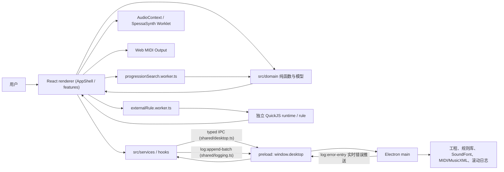
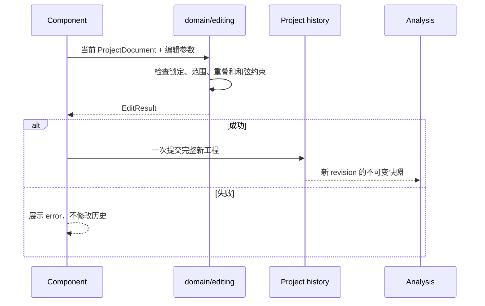

# 系统架构

本文说明 SATB Master 的运行时分层、跨进程契约、模块职责、依赖方向与静态架构门禁。数据契约见 [data-model.md](./data-model.md)，桌面端安全与持久化见 [desktop-and-persistence.md](./desktop-and-persistence.md)，双进程日志与排错体系见 [logging-and-observability.md](./logging-and-observability.md)。

## 1. 架构目标

项目需要同时满足五类要求：

1. 编辑操作必须可撤销、可验证，并在 React 和 Electron 之外保持可测试。
2. 和声检查、自动配和声与半自动和声连接需要理解连续时间上下文，同时不能阻塞编辑器交互。
3. 音频、实时 MIDI 输出、五线谱预览、播放头和标尺必须共享同一时间解释。
4. 本地文件、SoundFont、日志落盘和外置代码必须经过桌面端安全边界。
5. 主进程、渲染进程与 Worker 之间的契约（IPC、日志、外置规则协议）必须共享单一类型来源，避免双边漂移。

因此代码不是按页面简单分层，而是把音乐领域逻辑置于中心，用顶层 `shared/` 承载跨进程契约，将 React、Electron、音频工作线程和 Web Worker 都视为适配器或运行环境。

## 2. 运行时拓扑



主要隔离边界：

- **renderer 与领域层：** React 管理会话和交互，领域层决定工程是否合法；`src/domain` 不得依赖 React、Electron、DOM、Web Audio 或 `services/logging`。
- **renderer 与主进程：** 只能通过 [`electron/preload.cts`](../electron/preload.cts) 暴露的 `window.desktop` 调用白名单 IPC，通道名与请求/响应类型统一定义在 [`shared/desktop.ts`](../shared/desktop.ts)。
- **应用与外置规则：** 脚本运行于 [`externalRule.worker.ts`](../src/workers/externalRule.worker.ts) 内，每条规则使用独立 QuickJS runtime。
- **主线程与半自动和声连接搜索：** 多步连接搜索运行于 [`progressionSearch.worker.ts`](../src/workers/progressionSearch.worker.ts)，保持钢琴卷帘流畅响应。
- **主进程与本地大文件：** 用户 SoundFont 通过临时 token 协议流式读取，renderer 不获取任意路径读取能力。
- **双进程日志与错误上报：** 渲染进程日志经 `log:append-batch` 批量上送主进程 JSONL 滚动落盘；主进程 `error`/`fatal` 日志经 `log:error-entry` 实时反向推送给所有存活窗口，详见 [logging-and-observability.md](./logging-and-observability.md)。

## 3. 目录与职责

### 3.1 `shared`（跨进程契约层）

`shared/` 不依赖 React、DOM、Electron 或 Node 私有 API，供 `src/` 与 `electron/` 共同导入，保证跨进程协议单一事实来源：

| 文件 | 主要职责 |
| --- | --- |
| [`shared/desktop.ts`](../shared/desktop.ts) | `DESKTOP_CHANNELS`、`DesktopInvokeMap`、`DesktopEventMap`、`DesktopApi`、`LOG_SESSION_ARGUMENT` 与文件大小上限常量（如 `MAX_RULE_TEST_CASE_BYTES`、`MAX_AUDIT_FILE_BYTES`） |
| [`shared/logging.ts`](../shared/logging.ts) | 5 级 `LogLevel`、10 个 `LogScope`、3 类 `LogProcess`、15 个 `AppErrorCode`、`AppError`、路径脱敏/上下文安全序列化、`DiagnosticBundle`（`schemaVersion: 1`） |
| [`shared/external-rules.ts`](../shared/external-rules.ts) | 外置规则 API v3 共享常量、manifest 校验、配置与特例声明协议，供主进程规则库与渲染进程共用 |

### 3.2 `src/domain`

领域层不依赖 React、Electron、DOM、Web Audio 或 `services/logging`，负责可序列化模型和可重复的纯计算。

| 文件 / 目录 | 主要职责 |
| --- | --- |
| [`project/`](../src/domain/project) | 工程 schema v3、轨道和事件、默认工程、选择器、规范化、验证、终止式和弦覆盖与 v2 -> v3 迁移 |
| [`pitch.ts`](../src/domain/pitch.ts) | 书写音高、MIDI 转换、音程与调号相关计算 |
| [`chordModel.ts`](../src/domain/chordModel.ts) | 和弦实体、结构联合（含 `doubleAugmented43`）、语义解释、草稿解析与配器策略 |
| [`chordEditorModel.ts`](../src/domain/chordEditorModel.ts) | 和弦编辑器动作、共同和弦候选与草稿修正的纯逻辑 |
| [`functionalHarmonyCatalog.ts`](../src/domain/functionalHarmonyCatalog.ts) | 斯波索宾 A/B/C 功能词汇、组合约束与共同和弦候选 |
| [`chords.ts`](../src/domain/chords.ts) | 功能、罗马与绝对名称投影 |
| [`editing.ts`](../src/domain/editing.ts) | 新增、移动、调整、删除、锁定检查和批量命令 |
| [`time.ts`](../src/domain/time.ts) | tick、秒、小节、变拍号、变速与双向吸附 |
| [`rhythm/`](../src/domain/rhythm) | 节拍层级与强弱位置，供乐句、终止式和规则共用 |
| [`timelineRuler.ts`](../src/domain/timelineRuler.ts) | 标尺刻度与时间变化标签分组 |
| [`developerInspection.ts`](../src/domain/developerInspection.ts) | 开发者属性检查器的字段投影 |
| [`canonicalJson.ts`](../src/domain/canonicalJson.ts) | 确定性 JSON 规范序列化，用于内容寻址与比较 |
| [`midi.ts`](../src/domain/midi.ts) | MIDI Type 1 事件与轨道构造 |
| [`musicxml/`](../src/domain/musicxml) | MusicXML 乐谱导出模型、拍号/调号/连音线切分与 XML 序列化 |
| [`notation/`](../src/domain/notation) | VexFlow 记谱中间模型、大谱表分声部、临时记号与时值切分 |
| [`scoreText/`](../src/domain/scoreText) | 分块 SATB 文本谱（`.satbt`）解析、编译、渲染与参考答案分离，见 [score-text.md](./score-text.md) |
| [`audit/`](../src/domain/audit) | 教材审计包（`.satb-audit.json`）解析、版本绑定、预审问题与原图拍点锚点，见 [audit-workspace.md](./audit-workspace.md) |
| [`harmony/`](../src/domain/harmony) | 不可变分析快照、规则运行时、目录修订 3 的 70 条内置规则、共享事实（`facts/`）、调试快照（`debug/`）、乐句（`phrase/`）、终止式（`cadence/`）、和弦推导（`inference/`）、自动配和声与半自动连接（`harmonization/`，见 [harmonization.md](./harmonization.md)）及规则测试（`testing/`） |
| [`ruleProfile.ts`](../src/domain/ruleProfile.ts) | 工程规则设置命令、便携配置档案和新工程模板 |
| [`harmony/external/api.ts`](../src/domain/harmony/external/api.ts) | 外置 API v3 manifest 复用、公开只读上下文、配置与结果验证 |

领域代码的关键约束是：给定同一输入，返回同一结果；不读取 DOM、磁盘、系统时钟或全局可变状态。创建 ID 和时间戳的边界代码应把结果传入领域对象，而不是让规则计算隐式依赖环境。

### 3.3 `src/app`、`src/features`、`src/components` 与 `src/hooks`

[`src/main.tsx`](../src/main.tsx) 挂载全局错误捕获（`installGlobalErrorHandlers`）并用 [`AppErrorBoundary`](../src/components/AppErrorBoundary.tsx) 包裹应用根组件。[`src/App.tsx`](../src/App.tsx) 是稳定入口，实际应用壳位于 [`src/app/AppShell.tsx`](../src/app/AppShell.tsx)。`AppShell` 只组合工作区、控制器和通知栈，不直接承载文件、播放、搜索或规则调度的完整异步流程。

`src/app/controllers` 按工作流拆分会话控制：

- `useProjectController`：组合工程历史状态与编辑状态复位。
- `useFileWorkflow`：新建、打开、恢复、保存、另存为、关闭确认与 `singleFlight` 并发互斥。
- `usePlaybackController`：播放、暂停、循环、节拍器、SoundFont 生命周期、Web MIDI 输出协同和播放头同步。
- `useHarmonyController`：内置/外置规则运行、revision 竞争和诊断合并。
- `useProgressionAssistant`：管理半自动和声连接搜索状态、[`progressionSearch.worker.ts`](../src/workers/progressionSearch.worker.ts) 调度、幽灵预览、衔接试听与采纳写回，见 [harmonization.md](./harmonization.md)。
- `useEditorState` 与 `useEditorCommands`：选择、剪贴板、编辑意图与领域命令提交；`useEditorCommands` 内部在 [`editorCommands/`](../src/app/controllers/editorCommands) 下拆为 6 个职责子模块（`useNoteCommands`、`useChordCommands`、`useProjectCommands`、`useSelectionCommands`、`useTimingCommands`、`useViewCommands`）。
- `useKeyboardController`：全局与编辑器快捷键分发。
- `useRuleTestWorkspace`：规则测试工作台会话、用例读写与隔离执行。
- `useWindowController`：无边框窗口最大化状态与关闭控制。
- `useConfirmationController`：顶层确认请求的生命周期。
- [`singleFlight.ts`](../src/app/controllers/singleFlight.ts)：防并发重入的单飞异步门控（如文件保存/打开流程）。

`src/features` 按用户工作区拆分（共 14 个 feature）：

- [`features/editor`](../src/features/editor)：钢琴卷帘、幽灵预览层、交互联合类型、诊断聚合和统一 tick/MIDI 坐标（`viewport.ts`）。
- [`features/bottomPanel`](../src/features/bottomPanel)：底部四标签工作台容器（问题 / 五线谱 / 和声连接 / 日志），组合 `diagnostics`、`scorePreview`、`progressionAssistant`。
- [`features/diagnostics`](../src/features/diagnostics)：和声问题列表（`DiagnosticsPanel`）、会话日志工作台（`LogsPanel`）与未读错误角标统计（`useSessionLogErrors`）。
- [`features/scorePreview`](../src/features/scorePreview)：基于 VexFlow 5 的实时大谱表预览（底部内嵌面板与独立大窗口 `ScorePreviewDialog`）。
- [`features/autoHarmonization`](../src/features/autoHarmonization)：自动配和声（高音题/低音题）对话框、多方案预览与试听，见 [harmonization.md](./harmonization.md)。
- [`features/progressionAssistant`](../src/features/progressionAssistant)：半自动和声连接底部面板，见 [harmonization.md](./harmonization.md)。
- [`features/chordInference`](../src/features/chordInference)：自动和弦推导的引导与对话框，见 [analysis-inference.md](./analysis-inference.md)。
- [`features/inspector`](../src/features/inspector)：属性面板、和弦语义、时间事件、终止式编辑和开发者事件检查器。
- [`features/settings`](../src/features/settings)：设置窗口、内置/外置规则配置、编辑器偏好、快捷键和开发者模式开关。
- [`features/export`](../src/features/export)：统一导出对话框（MIDI Type 1 与 MusicXML）。
- [`features/midiOut`](../src/features/midiOut)：实时 Web MIDI 输出设备选择、通道模式与内部合成器静音配置对话框。
- [`features/ruleTesting`](../src/features/ruleTesting)：规则测试工作台，见 [rule-testing.md](./rule-testing.md)。
- [`features/audit`](../src/features/audit)：教材审计工作区，组合原谱/转写谱/钢琴卷帘三视图与预审意见往返，见 [audit-workspace.md](./audit-workspace.md)。
- [`features/tracks`](../src/features/tracks)：声部/轨道侧栏与赞助对话框。

`src/components` 仅保留跨 feature 复用的无业务耦合 UI 原语（不得导入 `src/features`）：

- [`AppErrorBoundary.tsx`](../src/components/AppErrorBoundary.tsx)：根级渲染崩溃恢复页，支持紧急 `.satb` 备份与脱敏排错包导出。
- [`AppNoticeStack.tsx`](../src/components/AppNoticeStack.tsx)：最多 3 条的优先级操作通知栈，支持警告/错误直接跳转定位底部日志。
- [`ConfirmDialog.tsx`](../src/components/ConfirmDialog.tsx)、[`IconButton.tsx`](../src/components/IconButton.tsx)、[`PanelResizeHandle.tsx`](../src/components/PanelResizeHandle.tsx)、[`cadenceRanges.ts`](../src/components/cadenceRanges.ts)。

`src/hooks` 负责把独立状态机和本地偏好接入 React：

- [`useDocumentHistory.ts`](../src/hooks/useDocumentHistory.ts) 与 [`useProjectHistory.ts`](../src/hooks/useProjectHistory.ts)：通用文档历史与工程撤销/重做、revision、dirty。
- [`useExternalRuleLibrary.ts`](../src/hooks/useExternalRuleLibrary.ts)：本机外置规则库状态同步。
- [`useShortcutBindings.ts`](../src/hooks/useShortcutBindings.ts)：快捷键绑定和本地配置。
- [`usePanelLayout.ts`](../src/hooks/usePanelLayout.ts)：面板尺寸、可见性及本地偏好。
- [`useDeveloperMode.ts`](../src/hooks/useDeveloperMode.ts)、[`useScaleGuide.ts`](../src/hooks/useScaleGuide.ts)、[`useFollowPlayhead.ts`](../src/hooks/useFollowPlayhead.ts)、[`usePausePlayheadBehavior.ts`](../src/hooks/usePausePlayheadBehavior.ts)：开发者模式、音阶辅助线、播放头跟随与暂停回位偏好。

规则设置不再由独立 hook/localStorage 维护。`AppShell` 通过控制器调用 `ruleProfile.ts` 的纯命令修改当前 `ProjectDocument.ruleProfile`，并把整个修改作为一次工程历史提交。

样式组织：[`src/styles/`](../src/styles) 仅保留 4 个全局基线样式，其余 feature 样式按模块就近放置在各 `src/features/<name>/`（以及 `src/components/`）目录下；[`src/styles.css`](../src/styles.css) 负责维持顶层全局与核心工作区样式的加载顺序：

- `src/styles/tokens.css`：全局字体、颜色基线和浏览器重置。
- `src/styles/window.css`：无边框窗口标题栏、窗口控制和引擎状态。
- `src/styles/layout.css`：工具栏、工作区、侧栏、赞助区和面板拖拽接缝。
- `src/styles/dialogs.css`：通用确认弹窗及动画。
- Feature 专属样式位于各自目录（如 `features/editor/editor.css`、`features/diagnostics/diagnostics.css`、`features/diagnostics/logsPanel.css`、`features/bottomPanel/bottomPanel.css`、`features/scorePreview/scorePreview.css`、`features/progressionAssistant/progressionAssistant.css`、`features/autoHarmonization/autoHarmonization.css`、`features/audit/audit.css` 等）。

### 3.4 `src/services`

services 是环境适配层。桌面模式转发到 `window.desktop`，浏览器模式提供 localStorage、IndexedDB、Blob 下载或内存实现。调用者不应根据 Electron IPC 细节组织业务流程，而应依赖这里的语义化接口。

- [`desktop.ts`](../src/services/desktop.ts)：工程、恢复、紧急备份、MIDI/MusicXML 导出、规则配置档案、SoundFont 流式加载、日志批处理与排错包导出的桌面/浏览器统一适配。
- [`logging/`](../src/services/logging)：渲染进程结构化日志总线（`logger.ts`）、面包屑、全局异常捕获与崩溃恢复用工程快照提供者（`emergencyProject.ts`），见 [logging-and-observability.md](./logging-and-observability.md)。
- [`audit.ts`](../src/services/audit.ts)：审计包 SHA-256 指纹计算、32 MiB/UTF-8 校验及基于 IndexedDB（`satb-master-audit`）的按版本独立会话持久化。
- [`clipboard.ts`](../src/services/clipboard.ts)：剪贴板写入与 `document.execCommand("copy")` 降级回退。
- [`externalRuleLibrary.ts`](../src/services/externalRuleLibrary.ts) 与 [`externalRuleRuntime.ts`](../src/services/externalRuleRuntime.ts)：外置规则包安装查询、Worker 生命周期、revision 竞争与结果汇总。
- [`ruleTestCases/`](../src/services/ruleTestCases)：规则测试用例的桌面/浏览器两套 store 与用例库，见 [rule-testing.md](./rule-testing.md)。

### 3.5 `src/audio`

音频层包装运行时音频与外设资源，不进入工程历史：

- [`audioEngine.ts`](../src/audio/audioEngine.ts)：AudioContext、SpessaSynth Worklet、节拍器与回退合成器调度。
- [`soundFontIdentity.ts`](../src/audio/soundFontIdentity.ts) 与 [`soundFontLifecycle.ts`](../src/audio/soundFontLifecycle.ts)：音源身份标识（避免同资源重复加载）与排他式 SoundBank 替换生命周期。
- [`midiOutput.ts`](../src/audio/midiOutput.ts)：Web MIDI API 输出设备枚举、热插拔管理、分轨道/单通道消息发送与配置持久化。

工程只保存 SoundFont 引用和播放相关持久配置，实际合成器、AudioNode、MIDI 端口句柄和待执行事件不能写入 `ProjectDocument`。

### 3.6 `electron`

主进程拥有窗口、文件系统、日志落盘和系统对话框权限：

- [`main.ts`](../electron/main.ts)：窗口创建、崩溃与异常退出钩子、IPC 错误归类上报、协议注册、启动审计包读取、导航策略和 IPC 装配。
- [`preload.cts`](../electron/preload.cts)：按 `shared/desktop.ts` 窄化暴露 `window.desktop`。
- [`typed-ipc.ts`](../electron/typed-ipc.ts)：类型安全的 `handleDesktop` 注册包装与 `setDesktopIpcReporter` 埋点（自动捕获错误与 `>= 500ms` 慢调用警告）。
- [`logger.ts`](../electron/logger.ts)：`MainLogger` JSONL 滚动落盘、内存环形缓冲、主进程错误反向推送和排错包导出 IPC。
- [`dialog-coordinator.ts`](../electron/dialog-coordinator.ts)：全局互斥的原生打开/保存对话框协调器，防止重复弹出叠窗。
- [`window-state.ts`](../electron/window-state.ts)：窗口尺寸、位置与最大化状态在 `userData/window-state.json` 中的防抖记忆与多屏可见性校验。
- [`project-ipc.ts`](../electron/project-ipc.ts)：工程打开/保存/紧急备份/恢复、MIDI 与 MusicXML 导出、规则配置档案及 7 类对话框目录记忆。
- [`soundfont-resource.ts`](../electron/soundfont-resource.ts) 与 [`soundfont-policy.ts`](../electron/soundfont-policy.ts)：大 SoundFont 的 2 GiB/内存余量策略校验、短时 token 协议与分块 SHA-256 哈希。
- [`rule-library.ts`](../electron/rule-library.ts) 与 [`rule-library-policy.ts`](../electron/rule-library-policy.ts)：本机规则包内容寻址存储与 API v3 manifest/hash/容量校验。
- [`rule-test-cases.ts`](../electron/rule-test-cases.ts) 与 [`rule-test-case-file.ts`](../electron/rule-test-case-file.ts)：规则测试用例目录扫描与原子写盘，见 [rule-testing.md](./rule-testing.md)。
- [`dev-extensions.ts`](../electron/dev-extensions.ts)：开发模式自动探测并加载本机 Chrome/Edge/Brave 的 React DevTools 扩展。

策略类纯逻辑尽量放入可测试模块（如 `soundfont-policy.ts`、`rule-library-policy.ts`、`window-state.ts`），而不是埋在 IPC handler 中。

### 3.7 `src/workers`

项目包含两个专用 Web Worker，避免重计算或第三方脚本阻塞 UI 线程：

- [`externalRule.worker.ts`](../src/workers/externalRule.worker.ts)：接收裁剪并冻结的音乐上下文，在独立 QuickJS runtime 中执行外置规则，受堆/栈/时间与全局对象隔离保护。
- [`progressionSearch.worker.ts`](../src/workers/progressionSearch.worker.ts)：运行半自动和声连接搜索（`searchProgressionCandidates`），异步返回单和弦排列变体与 2–4 步短连接候选。

## 4. 依赖方向

推荐依赖方向：

```text
app/AppShell + app/controllers
        |
        +--> features --> domain
        +--> components
        |
        +--> services (含 logging) --> shared <-- Electron main
        |        |                                    ^
        |        +----------> preload ----------------+
        +--> audio (SpessaSynth + Web MIDI)
        +--> workers (externalRule / progressionSearch)
```

不允许反向依赖：

- `domain` 不导入 React、Electron、DOM、`window.desktop`、Web Audio 或 `services/logging`。
- `components` 不导入任何 `features/` 实现。
- Electron 主进程不导入 renderer 组件。
- 外置脚本不能接收 `window.desktop`、DOM 或可变的完整应用状态。
- UI 组件不直接读取任意本地文件路径。

若一个新功能需要在多种环境运行，先在领域层定义纯数据和纯操作，再由 service 分别实现 Electron 与浏览器能力。

## 5. 核心数据流

### 5.1 编辑事务



拖动时可以在 UI 层显示预测位置，但鼠标松开后必须由领域命令重新验证。批量编辑中任何一项失败时，整批不应留下半完成状态。

### 5.2 和声检查

工程快照先转换为时间切片、声部转换、连续和弦跨度、精确和弦连接和共享事实（[`src/domain/harmony/facts/`](../src/domain/harmony/facts)）。内置规则经过工程 profile、适用性计划、结果校验和诊断仲裁；外置 API v3 在 Worker 中读取同一裁剪语义快照。只修改规则 profile 时复用音乐分析并只重跑变化规则；每次请求携带 revision，旧请求即使晚返回也不能覆盖新工程结果。详见 [harmony-engine.md](./harmony-engine.md)。

### 5.3 播放与实时输出

播放控制根据工程 tempo/meter 事件把 tick 转换为 AudioContext 时间，提前调度可见轨道的音符和节拍器，并在启用实时 MIDI 输出时同步通过 `midiOutputManager` 发送 noteOn/noteOff/ProgramChange。暂停不仅停止动画，还要取消未来事件、停止合成器发声、发送 MIDI 全音符关闭并关闭输出路径。详见 [audio-midi-and-time.md](./audio-midi-and-time.md)。

### 5.4 文件、恢复与日志

显式保存把完整 `ProjectDocument` 发送到主进程，验证后以同目录临时文件加 rename 方式替换目标文件。dirty 工程另有防抖恢复副本；恢复不是保存，也不会自动获得原文件路径。详见 [desktop-and-persistence.md](./desktop-and-persistence.md)。全链路异常与慢 IPC 统一汇入 `userData/logs/` 会话日志，详见 [logging-and-observability.md](./logging-and-observability.md)。

## 6. 不可变快照与 revision

项目以不可变工程帧驱动编辑、分析与异步搜索：

- 每次成功命令返回新的 `ProjectDocument`。
- 历史 hook 为新帧分配单调增加的 revision。
- 和声分析冻结项目快照，规则不得修改输入。
- 外置规则请求和结果都带 revision；服务层只接受当前 revision 的结果，较旧结果标记为 superseded。

这套机制同时解决撤销、异步规则竞争和开发者调试可复现性。不要在现有工程对象上就地修改事件；即使 React 偶尔能够重新渲染，也会破坏历史帧和正在运行的分析。

## 7. 浏览器降级边界

浏览器模式用于快速 UI 开发，并提供：

- localStorage 工程、恢复数据与外置规则库。
- IndexedDB 教材审计会话持久化。
- 浏览器 Blob 下载形式的 MIDI、MusicXML、规则档案、紧急 `.satb` 备份与排错包导出。
- 内存级日志缓冲与排错包构建（无磁盘 JSONL 落盘与主进程错误推送）。
- Web Audio / Web MIDI 播放能力。

它不能等价验证：

- 本地路径重载和大 SoundFont token 协议。
- 原子文件保存、schema 备份、滚动日志落盘和系统对话框目录。
- frameless 窗口、窗口尺寸记忆、焦点、恢复弹窗与原生菜单交互。
- 安装包资源路径、ASAR 和用户数据目录。

涉及这些边界的改动必须在 Electron 开发模式或打包产物中验证。

## 8. 新功能放置判断

| 问题 | 放置位置 |
| --- | --- |
| 主进程与渲染进程共享的数据/通道契约 | `shared/desktop.ts`、`shared/logging.ts`、`shared/external-rules.ts` |
| 是否允许某次编辑 | `src/domain/editing.ts` |
| 工程要永久保存什么 | `src/domain/project/types.ts`、`defaults.ts`、`validation.ts`、`normalize.ts` 与 `migrations/`，并通过 `project/index.ts` 导出 |
| tick 如何解释 | `src/domain/time.ts` |
| 和弦/音高如何解释 | `src/domain/chordModel.ts`、`functionalHarmonyCatalog.ts`、`pitch.ts` |
| 规则如何取上下文、事实和发诊断 | `src/domain/harmony/`（`facts/`、`rules/`、`runtime.ts`） |
| 记谱/导出转换 | `src/domain/notation/`、`src/domain/musicxml/`、`src/domain/midi.ts` |
| 用户如何触发与组合工作区 | `src/features/*`、`src/app/controllers/*`、`src/components`、`src/hooks` 与 `src/shortcuts` |
| 文件、路径、日志落盘或系统能力 | `src/services/*` + `electron/preload.cts` + `electron/*` |
| 合成器与外部 MIDI 运行时资源 | `src/audio/*` |
| 耗时搜索或隔离脚本执行 | `src/workers/*` |

若答案跨越多个格子，先定义领域或共享契约，再逐层接入。不要从 IPC 或 UI 数据形状倒推领域模型。

## 9. 架构变更检查表

- 新数据是否必须随工程保存？若是，是否更新 schema、验证、默认值和迁移测试？
- 新编辑是否经过纯命令，并同时覆盖锁定、重叠和批量原子性？
- 新时间计算是否复用了 `time.ts`？
- 新异步任务是否携带 revision 或取消令牌，并拒绝过期结果？
- 新本地能力是否先在 `shared/desktop.ts` 声明，再经 `handleDesktop` 与固定 preload 方法暴露？
- 新增错误处理是否使用统一 logger，而未在生产代码引入裸 `console.warn` / `console.error`？
- 新规则上下文是否只读、可序列化且没有泄露辅助轨明细或系统对象？
- 长工程下的绘制、查询和数组构造是否以视口或局部范围为边界？
- 浏览器预览、Electron 开发模式和安装包三种环境分别需要怎样验证？

## 10. 静态架构门禁与验证入口

架构边界由 [`electron/architecture-boundaries.test.ts`](../electron/architecture-boundaries.test.ts) 作为 Vitest 测试持续执行，当前强制检查 6 项静态规则：

1. **领域层零运行时依赖：** `src/domain` 下所有源码不得导入 `react`、`electron`、`services/logging`，也不得引用 `window.desktop`、`AudioContext` 或 `document.`。
2. **统一日志出口：** `src/` 与 `electron/` 的生产代码禁止直接调用裸 `console.warn` / `console.error`（含可选链与方括号下标写法；仅豁免测试/声明文件及 `electron/logger.ts`、`src/services/logging/logger.ts`）。
3. **旧入口黑名单：** 已移除的旧兼容入口（`domain/model.ts`、`domain/harmony.ts`、`domain/harmonyAnalysis.ts`、`domain/harmonyRuntime.ts`、`domain/harmonyRules.ts`、`domain/externalRules.ts`、`domain/externalRuleSandbox.ts`、`domain/externalRuleWorkerProtocol.ts`、`domain/rules/`、`components/PianoRoll.tsx`、`components/Inspector.tsx`、`components/ShortcutSettings.tsx`）必须保持不存在。
4. **公共入口约束：** `app/`、`features/`、`hooks/`、`services/`、`audio/` 不得绕过包入口直接深层导入 `domain/model`、`domain/harmony/(ruleTypes|runtime|analysis)` 或 `features/(editor|inspector|settings|diagnostics|tracks)/` 内部文件。
5. **通用组件隔离：** `src/components/` 不得依赖任何 `src/features/` 模块。
6. **跨 feature 依赖白名单：** 除组合型工作区按显式白名单消费公共入口外，禁止 feature 间互相导入：
   - `ruleTesting` -> `editor`、`inspector`、`settings`、`tracks`
   - `bottomPanel` -> `diagnostics`、`scorePreview`、`progressionAssistant`
   - `audit` -> `scorePreview`、`editor`、`inspector`

钢琴卷帘的纯坐标契约由 [`features/editor/viewport.test.ts`](../src/features/editor/viewport.test.ts) 覆盖，包括 tick 与横坐标、MIDI 与纵坐标、时值宽度和缩放锚点。样式拆分必须保持 [`src/styles.css`](../src/styles.css) 的 import 顺序；桌面端的无边框窗口、恢复弹窗和资源路径仍需在 Electron 环境中通过 E2E 与手工冒烟验证。
