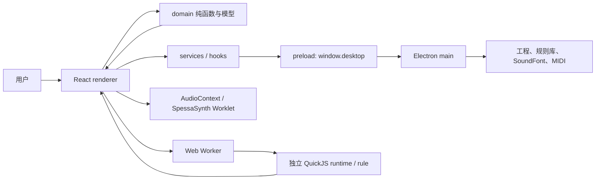
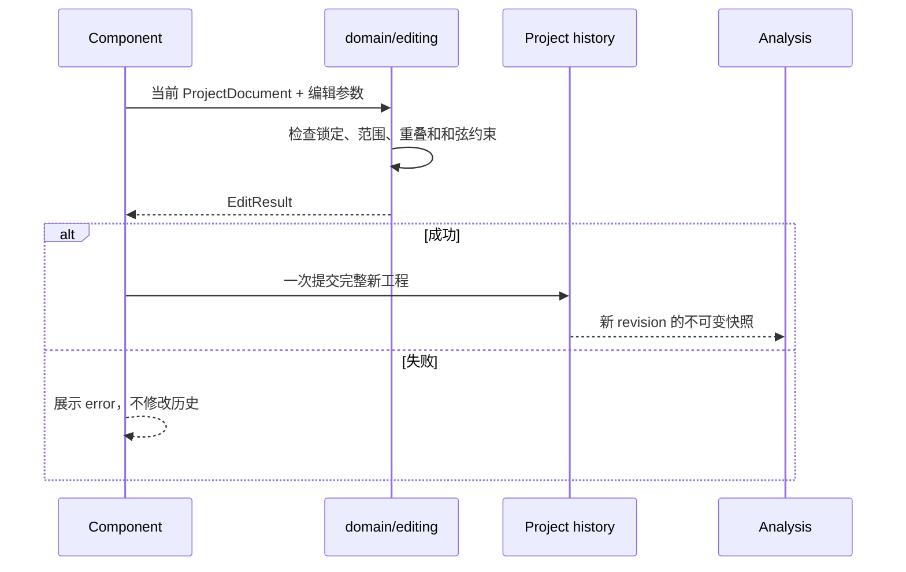

# 系统架构

本文说明 SATB Master 的运行时分层、模块职责和跨边界数据流。数据契约见 [data-model.md](./data-model.md)，桌面端安全与持久化见 [desktop-and-persistence.md](./desktop-and-persistence.md)。

## 1. 架构目标

项目需要同时满足四类要求：

1. 编辑操作必须可撤销、可验证，并在 React 和 Electron 之外保持可测试。
2. 和声检查需要理解连续时间上下文，同时不能阻塞编辑器。
3. 音频、MIDI、播放头和标尺必须共享同一时间解释。
4. 本地文件、SoundFont 和外置代码必须经过桌面端安全边界。

因此代码不是按页面简单分层，而是把音乐领域逻辑置于中心，将 React、Electron、音频工作线程和 QuickJS 都视为适配器或运行环境。

## 2. 运行时拓扑



主要隔离边界：

- **renderer 与领域层：** React 管理会话和交互，领域层决定工程是否合法。
- **renderer 与主进程：** 只能通过 [`electron/preload.cts`](../electron/preload.cts) 暴露的 `window.desktop` 调用白名单 IPC。
- **应用与外置规则：** 脚本位于 Web Worker 内，每条规则使用独立 QuickJS runtime。
- **主进程与本地大文件：** 用户 SoundFont 通过临时 token 协议流式读取，renderer 不获取任意路径读取能力。

## 3. 目录与职责

### 3.1 `src/domain`

领域层不依赖 React 或 Electron，负责可序列化模型和可重复的纯计算。

| 文件 | 主要职责 |
| --- | --- |
| [`model.ts`](../src/domain/model.ts) | 工程 schema、轨道和事件、默认工程、验证与 v2 -> v3 迁移 |
| [`pitch.ts`](../src/domain/pitch.ts) | 书写音高、MIDI 转换、音程与调号相关计算 |
| [`chordModel.ts`](../src/domain/chordModel.ts) | 和弦实体、结构联合、语义解释、草稿解析与配器策略 |
| [`functionalHarmonyCatalog.ts`](../src/domain/functionalHarmonyCatalog.ts) | 斯波索宾 A/B/C 功能词汇、组合约束与共同和弦候选 |
| [`chords.ts`](../src/domain/chords.ts) | 功能、罗马与绝对名称投影 |
| [`editing.ts`](../src/domain/editing.ts) | 新增、移动、调整、删除、锁定检查和批量命令 |
| [`time.ts`](../src/domain/time.ts) | tick、秒、小节、变拍号、变速与双向吸附 |
| [`midi.ts`](../src/domain/midi.ts) | MIDI Type 1 事件与轨道构造 |
| [`harmonyAnalysis.ts`](../src/domain/harmonyAnalysis.ts) | 不可变快照、切片、转换、和声跨度与遍历查询 |
| [`harmonyRuntime.ts`](../src/domain/harmonyRuntime.ts) | 规则接口、调度、私有状态、适用性接入与诊断收敛 |
| [`harmonyRules.ts`](../src/domain/harmonyRules.ts) | 当前内置规则实现与运行注册表 |
| [`rules/`](../src/domain/rules) | 81 条目录、配置 schema、共享事实、连接器、适用性与仲裁 |
| [`ruleProfile.ts`](../src/domain/ruleProfile.ts) | 工程规则设置命令、便携配置档案和新工程模板 |
| [`externalRules.ts`](../src/domain/externalRules.ts) | 外置 API v3 manifest、公开上下文、配置和结果验证 |

领域代码的关键约束是：给定同一输入，返回同一结果；不读取 DOM、磁盘、系统时钟或全局可变状态。创建 ID 和时间戳的边界代码应把结果传入领域对象，而不是让规则计算隐式依赖环境。

### 3.2 `src/components`、`src/hooks` 与 `src/App.tsx`

[`src/App.tsx`](../src/App.tsx) 是应用编排层，组合工程历史、播放、规则、桌面服务、布局和弹窗状态。它可以决定何时调用一个领域命令，但不应重新实现该命令的合法性判断。

组件负责：

- 把指针、键盘和表单操作翻译成领域命令参数。
- 展示工程快照、诊断、播放状态和服务错误。
- 维护拖拽预览等尚未提交的短生命周期 UI 状态。

hooks 负责把独立状态机接入 React，例如：

- [`useProjectHistory.ts`](../src/hooks/useProjectHistory.ts)：撤销、重做、revision 与 dirty。
- [`useShortcutBindings.ts`](../src/hooks/useShortcutBindings.ts)：快捷键绑定和本地配置。
- [`usePanelLayout.ts`](../src/hooks/usePanelLayout.ts)：面板尺寸及本地偏好。

规则设置不再由独立 hook/localStorage 维护。`App.tsx` 通过 `ruleProfile.ts` 的纯命令修改当前 `ProjectDocument.ruleProfile`，并把整个修改作为一次工程历史提交。

### 3.3 `src/services`

services 是环境适配层。桌面模式转发到 `window.desktop`，浏览器模式提供 localStorage、下载或内存实现。调用者不应根据 Electron IPC 细节组织业务流程，而应依赖这里的语义化接口。

外置规则还使用：

- [`externalRuleLibrary.ts`](../src/services/externalRuleLibrary.ts)：导入、安装和查询规则包。
- [`externalRuleRuntime.ts`](../src/services/externalRuleRuntime.ts)：Worker 生命周期、revision 竞争和结果汇总。

### 3.4 `src/audio`

音频层包装 AudioContext、SpessaSynth 和回退合成器。它维护的是运行时资源，不属于工程历史。工程只保存 SoundFont 引用和播放相关持久配置，实际合成器、节点和待执行事件不能写入 `ProjectDocument`。

### 3.5 `electron`

主进程拥有窗口、文件系统和系统对话框权限。主要分组包括：

- [`main.ts`](../electron/main.ts)：窗口创建、协议注册、导航策略和 IPC 装配。
- [`preload.cts`](../electron/preload.cts)：窄化后的 renderer API。
- [`project-ipc.ts`](../electron/project-ipc.ts)：工程打开、保存、恢复、MIDI、规则配置档案与分类型对话框目录。
- [`soundfont-resource.ts`](../electron/soundfont-resource.ts)：大 SoundFont 的 token、哈希和流读取。
- [`rule-library.ts`](../electron/rule-library.ts)：本机规则包内容寻址存储。

策略类纯逻辑尽量放入可测试模块，例如 SoundFont 和规则库的路径/容量策略，而不是埋在 IPC handler 中。

### 3.6 `src/workers`

[`externalRule.worker.ts`](../src/workers/externalRule.worker.ts) 接收已经裁剪并冻结的音乐上下文，在 QuickJS 中装载规则。Worker 是避免阻塞 renderer 的第一层隔离，QuickJS 的堆、栈、时间和全局对象限制是第二层隔离。

## 4. 依赖方向

推荐依赖方向：

```text
components/hooks/App
        |
        +--> domain
        +--> services --> preload --> Electron main
        +--> audio
        +--> Worker --> QuickJS
```

不允许反向依赖：

- `domain` 不导入 React、Electron、Web Audio 或 Worker。
- Electron 主进程不导入 renderer 组件。
- 外置脚本不能接收 `window.desktop`、DOM 或可变的完整应用状态。
- UI 组件不直接读取任意本地文件路径。

若一个新功能需要在多种环境运行，先在领域层定义纯数据和纯操作，再由 service 分别实现 Electron 与浏览器能力。

## 5. 核心数据流

### 5.1 编辑事务



拖动时可以在 UI 层显示预测位置，但鼠标松开后必须由领域命令重新验证。批量编辑中任何一项失败时，整批不应留下半完成状态。

### 5.2 和声检查

工程快照先转换为时间切片、声部转换、连续和弦跨度、精确和弦连接和共享事实。内置规则经过工程 profile、适用性计划、结果校验和诊断仲裁；外置 API v3 在 Worker 中读取同一裁剪语义快照。每次请求携带 revision，旧请求即使晚返回也不能覆盖新工程结果。详见 [harmony-engine.md](./harmony-engine.md)。

### 5.3 播放

播放控制根据工程 tempo/meter 事件把 tick 转换为 AudioContext 时间，提前调度可见轨道的音符和节拍器。暂停不仅停止动画，还要取消未来事件、停止合成器发声并关闭输出路径。详见 [audio-midi-and-time.md](./audio-midi-and-time.md)。

### 5.4 文件与恢复

显式保存把完整 `ProjectDocument` 发送到主进程，验证后以同目录临时文件加 rename 方式替换目标文件。dirty 工程另有防抖恢复副本；恢复不是保存，也不会自动获得原文件路径。详见 [desktop-and-persistence.md](./desktop-and-persistence.md)。

## 6. 不可变快照与 revision

项目以不可变工程帧驱动编辑和分析：

- 每次成功命令返回新的 `ProjectDocument`。
- 历史 hook 为新帧分配单调增加的 revision。
- 和声分析冻结项目快照，规则不得修改输入。
- 外置规则请求和结果都带 revision。
- 服务层只接受当前 revision 的结果，较旧结果标记为 superseded。

这套机制同时解决撤销、异步规则竞争和开发者调试可复现性。不要在现有工程对象上就地修改事件；即使 React 偶尔能够重新渲染，也会破坏历史帧和正在运行的分析。

## 7. 浏览器降级边界

浏览器模式用于快速 UI 开发，并提供：

- localStorage 工程与恢复数据。
- 浏览器下载形式的 MIDI 导出。
- localStorage 形式的外置规则库。
- Web Audio 播放能力。

它不能等价验证：

- 本地路径重载和大 SoundFont token 协议。
- 原子文件保存、schema 备份和系统对话框目录。
- frameless 窗口、焦点、恢复弹窗与原生菜单交互。
- 安装包资源路径、ASAR 和用户数据目录。

涉及这些边界的改动必须在 Electron 开发模式或打包产物中验证。

## 8. 新功能放置判断

| 问题 | 放置位置 |
| --- | --- |
| 是否允许某次编辑 | `src/domain/editing.ts` |
| 工程要永久保存什么 | `src/domain/model.ts` 并升级/迁移 schema |
| tick 如何解释 | `src/domain/time.ts` |
| 和弦/音高如何解释 | `src/domain/chordModel.ts`、`functionalHarmonyCatalog.ts`、`pitch.ts` |
| 规则如何取上下文和发诊断 | 和声 analysis/runtime/rules |
| 用户如何触发 | component/hook/shortcut registry |
| 文件、路径或系统能力 | service + preload + Electron main |
| 合成器运行时资源 | `src/audio` |

若答案跨越多个格子，先定义领域契约，再逐层接入。不要从 IPC 或 UI 数据形状倒推领域模型。

## 9. 架构变更检查表

- 新数据是否必须随工程保存？若是，是否更新 schema、验证、默认值和迁移测试？
- 新编辑是否经过纯命令，并同时覆盖锁定、重叠和批量原子性？
- 新时间计算是否复用了 `time.ts`？
- 新异步任务是否携带 revision，并拒绝过期结果？
- 新本地能力是否只通过窄 preload API 暴露？
- 新规则上下文是否只读、可序列化且没有泄露辅助轨明细或系统对象？
- 长工程下的绘制、查询和数组构造是否以视口或局部范围为边界？
- 浏览器预览、Electron 开发模式和安装包三种环境分别需要怎样验证？
