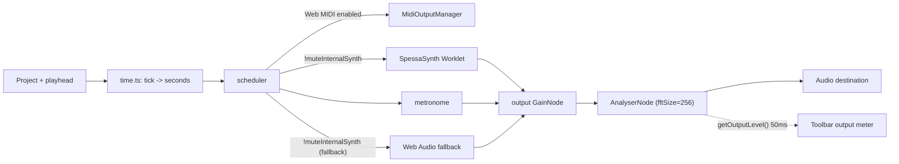

# 时间轴、音频与 MIDI

本文说明 tick/秒/小节的统一换算、播放调度、SoundFont 生命周期和 MIDI Type 1 导出。工程时间事件见 [data-model.md](./data-model.md)，本地资源协议见 [desktop-and-persistence.md](./desktop-and-persistence.md)。

## 1. 单一时间来源

[`src/domain/time.ts`](../src/domain/time.ts) 是时间解释的唯一来源。常用导出函数包括：

- 事件与位置查询：`orderedEvents`、`eventAtTick`、`tempoAtTick`、`keyAtTick`、`meterAtTick`、`measureAtTick`、`tickToPosition`、`formatPosition`
- 小节与时值换算：`ticksPerBeat`、`buildMeasures`、`ticksForMeasures`、`durationToTicksAt`
- 秒/tick 双向换算：`tickToSeconds`、`secondsToTick`
- 网格吸附：`snapTickBackward`、`snapTickForward`、`nearestGridTick`

播放器、播放头动画、循环、节拍器、标尺、工程总小节数和 MIDI 不能各自维护一套近似公式。

固定基准：

```text
PPQ = 960 tick / quarter note
```

但“一拍”取决于拍号分母：

```text
ticksPerBeat = PPQ * 4 / denominator
ticksPerMeasure = ticksPerBeat * numerator
```

例如 6/8 的记谱拍单位与 4/4 不同。节拍器是否按复拍子的大拍分组属于播放策略，但小节边界必须先由 meter 事件准确建立。

## 2. 变速与 tick/秒换算

tempo 事件把时间轴分成多个恒速段。`tickToSeconds` 需要累加目标 tick 之前每一段的持续秒数，再计算所在段的剩余部分。`secondsToTick` 做相反的分段搜索。

```text
tick 0 --120 BPM-- tick A --90 BPM-- tick B
```

不能用“当前 BPM”把整个工程一次相除，否则：

- 从中间开始播放会错位。
- 播放头与实际声音逐渐分离。
- 循环回绕点不准确。
- MIDI 和应用内播放时长不一致。

新增速度曲线前，需要先扩展领域时间模型和双向换算，不应只在 audio scheduler 中插值。

## 3. 变拍号与小节

工程设置以小节数呈现，总长度仍以 `lengthTicks` 持久化。`buildMeasures` 按 meter 事件建立每个小节的开始、结束和拍结构，`ticksForMeasures` 用于把用户输入的小节数转换为工程长度。

变拍号发生在合法小节边界时，后续小节使用新长度。UI 调整总小节数时应：

- 使用当前 meter 事件序列计算目标 tick。
- 检查已有音符、和弦、循环和全局事件是否超出新结尾。
- 明确拒绝或通过领域命令处理，不能只裁剪画布。

标尺刻度和节拍器也应遍历 `buildMeasures` 结果，以确保看到的拍点与听到的点击一致。

## 4. 吸附方向

编辑器需要两个方向明确的函数：

```text
起点/移动位置 -> snapTickBackward
拖拽结束边界 -> snapTickForward
```

向前取整避免点击网格后半段时意外跳到下一格；向后取整保证拖过边界即可获得完整时值。除非某个命令明确要求“最近拍点”，不要使用 `Math.round(tick / grid) * grid`。

## 5. 音频架构

[`src/audio/audioEngine.ts`](../src/audio/audioEngine.ts) 管理 AudioContext、SpessaSynth、预听、播放调度、节拍器、输出电平采样与无 SoundFont 回退，并与 [`src/audio/midiOutput.ts`](../src/audio/midiOutput.ts) 的 `MidiOutputManager` 协同输出外部实时 MIDI 信号。工程中的音符保持纯数据，播放时转换为合成事件。



- SpessaSynth AudioWorklet 必须显式连接到输出链（`synth.connect(this.output)`）。成功创建处理器但未连接 destination 会表现为“播放动画正常但完全无声”。
- `output GainNode` 串联一个 `AnalyserNode`（`fftSize = 256`）再连接 `context.destination`；`audioEngine.getOutputLevel()` 读取时域峰值，供 [`usePlaybackController.ts`](../src/app/controllers/usePlaybackController.ts) 以 50ms 间隔轮询驱动工具栏电平表。
- 当开启 Web MIDI 输出且勾选「静音内置合成器」（`midiOutputManager.shouldMuteInternalSynth()`）时，音符播放与单音预听跳过 SpessaSynth 与回退振荡器，仅向外部 MIDI 端口发送信号（节拍器仍按需走本地音频链）。

## 6. 初始化与默认音色

应用启动和打开工程后会立即预载工程引用的 SoundFont，而不是等第一次点击播放。这样可以：

- 第一次画音符就能预听。
- 第一次播放不会因大文件解析产生明显延迟。
- 初始化失败能提前显示并使用回退合成器。

浏览器的自动播放策略可能要求用户手势后才能 `resume()` AudioContext，但资源获取和解析可以提前进行。不要把“Context 尚未允许发声”误判为“应把工程音色重置为默认”。

默认 SoundFont 位于：

```text
public/soundfonts/default.sf2
public/soundfonts/default.sf2.sha256
public/soundfonts/LICENSE-default-soundfont.txt
public/soundfonts/README.md
```

它由 [`scripts/generate-default-soundfont.mjs`](../scripts/generate-default-soundfont.mjs) 使用确定性的数学波形生成，不包含第三方采样，包含程序 52/53。更新脚本后运行：

```powershell
npm run generate:soundfont
```

提交生成文件、哈希、许可证说明和脚本变更，并验证生产资源路径。

## 7. 用户 SoundFont 生命周期

### 7.1 桌面端与浏览器端加载路径

桌面端（Electron）本地 SF2/SF3 的加载跨 renderer 与主进程：

```text
系统对话框选择路径
-> 主进程检查扩展名、大小、位数和可用内存策略
-> 创建 15 分钟短期 token
-> unloadSoundFont(generation) 释放旧音色内存
-> renderer 从 satb-soundfont://resource/<token> 流式读取
-> SHA-256 与读取进度并行
-> installExclusiveSoundFont 销毁重建 WorkletSynthesizer 并装入新库
-> release token
```

限制来自 [`electron/soundfont-policy.ts`](../electron/soundfont-policy.ts)：

- 文件硬上限 2 GiB（`MAX_SOUNDFONT_BYTES`）。
- 32 位进程中，超过 512 MiB 明确拒绝。
- 内存预算按 `文件大小 * 1.5 + 512 MiB 系统保留` 估算。

2 GiB 是接收文件的目标上限，不承诺所有机器都能成功解析 2 GiB 音色。SpessaSynth、WASM 地址空间、系统可用内存和 SF2 内部结构都可能成为更早限制。主进程不把任意本地路径交给 renderer 的 `fetch`；token 只对应已经验证的文件，15 分钟后过期，加载完成或取消后主动释放。

浏览器端（无 `window.desktop`）由 [`usePlaybackController.ts`](../src/app/controllers/usePlaybackController.ts) 的 `handleChooseSoundFont` 通过动态 `<input type="file" accept=".sf2,.sf3">` 选择文件，校验同样不超过 2 GiB（`MAX_SOUNDFONT_BYTES`），卸载旧音色后用 `URL.createObjectURL(file)` 交由 `readSoundFontBuffer` 分块读取并报告进度，读取完成后在 `finally` 中 `URL.revokeObjectURL` 释放对象 URL。

### 7.2 独占装载与内存释放

- **销毁重建 Worklet（[`src/audio/soundFontLifecycle.ts`](../src/audio/soundFontLifecycle.ts)）**：SpessaSynth 不允许删除最后一个已装载的 SoundBank；因此切换不同音源时，`installExclusiveSoundFont` 会先调用旧 `WorkletSynthesizer.destroy()` 再通过 `createReplacement` 创建新实例并装入目标 `buffer`，防止旧库残留继续参与预置匹配。
- **加载前主动卸载**：加载大音色或切换工程音色前，`ensureSoundFontLoaded` 与 `handleChooseSoundFont` 先调用 `audioEngine.unloadSoundFont(generation)` 销毁旧合成器并释放采样内存，避免旧采样与新文件缓冲区同时占据峰值内存。

### 7.3 选择竞争与音源标识

SoundFont 读取和解析是异步的。`soundFontChangeGeneration` 与串行加载队列保证最后一次用户选择生效：

- 较旧加载即使晚完成，也不能覆盖新选择。
- 点击播放不能重新应用默认音色并覆盖已加载本地音色。
- 加载失败时释放异常合成器并回退到 Web Audio 回退音色，同时向界面报告失败原因。

工程打开时的音色引用、默认预载和用户手动选择都必须经过同一代际判断。[`src/audio/soundFontIdentity.ts`](../src/audio/soundFontIdentity.ts) 区分两个标识函数：

- `soundFontId(soundFont)`：标识实际音源内容（默认音色为 `"default"`，用户音色为 `` `user:${hash ?? path ?? name}` ``）；显示名称变化不会触发同一资源重新加载，同一 ID 正在加载时预载、播放与界面切换共享同一个请求。
- `soundFontLoadKey(soundFont)`：同时编码 `hash` 与 `path` 的加载定位键；同一内容文件被移动路径后，若尚未加载到内存，可通过新的 `loadKey` 从新路径重试读取。

## 8. 回退合成器与预听

无可用 SF2 时，Web Audio 三角波作为可用性回退。它不是最终音色，但应支持：

- 单音符新建预听。
- 单选移动/变调预听。
- 正常播放和停止。

多选移动不触发逐个音符预听，防止声音堆叠。擦除不需要预听。

预听与主播放共享输出资源时要区分事件所有者。暂停播放不应永久破坏之后的编辑预听；重新预听必须能打开正确增益并建立自己的短事件。

## 9. 播放、暂停和循环

播放包含两条并行链：

- 音频 scheduler 根据 tick/秒关系安排未来合成事件（包括 SpessaSynth 与 Web MIDI 输出）。
- 动画根据 `AudioContext.currentTime` 更新 `playheadTick`。

暂停（`audioEngine.stop()`）必须同时处理本地音频与外部 MIDI：

1. 递增 `synthScheduleGeneration`，取消定时调度器与预览定时器。
2. 停止 `requestAnimationFrame` 与段末 `stopTimer`。
3. 调用合成器 `stopAll(true)`。
4. 同步发送 `midiOutputManager.allNotesOff()` 防止外部设备挂音。
5. 将输出 `GainNode` 归零截断残响，并停止所有回退振荡器。
6. 按暂停行为策略更新播放头位置。

只停动画会导致“红线不动但声音继续”。只关闭增益而不取消事件会让恢复后旧事件泄漏。

### 9.1 暂停播放头行为、防重入与循环回绕

- **三种暂停播放头策略（[`usePausePlayheadBehavior.ts`](../src/hooks/usePausePlayheadBehavior.ts)）**：持久化于 `satb-master-pause-playhead-v1`，支持 `"current"`（停留在当前位置，默认）、`"playback-start"`（返回本次起播位置 `playbackStartTickRef`）与 `"loop-start"`（返回工程循环起点 `loopStartTick`）。显式点击「回到开头」传 `returnToStart = true` 时直接归零。
- **防重入与防晚到起播**：[`usePlaybackController.ts`](../src/app/controllers/usePlaybackController.ts) 用 `createSingleFlight()`（[`singleFlight.ts`](../src/app/controllers/singleFlight.ts)）包装 `startPlayback`，防止连点播放并发启动；同时每次起播递增 `playSessionRef`，并在 `preparePlaybackAudio` 与 `audioEngine.playProject` 内检查 `shouldStart()`（即 `playSessionRef.current === session`），若在异步准备音色期间用户已点击停止或发起新会话，晚到的起播会被立即阻断。
- **逐段回绕循环**：循环范围来自工程 `project.loop`；`usePlaybackController` 内的 `playSegment(segmentStart)` 将每段终点设为 `loopEnabled ? loopEndTick : project.lengthTicks`，段末 `onStop` 回调在 `playSessionRef` 仍有效且 `loopEnabled` 为真时将播放头复位至 `loopStartTick` 并递归调用 `playSegment(loopStartTick)`。由于每段时长都经 `tickToSeconds` 计算，变速区间内的循环不会发生漂移。

## 10. 节拍器

节拍器在 `audioEngine.playProject` 中作为 AudioContext 时间轴上的振荡器事件调度，与主播放一同取消（不另建独立 `setInterval` 计时器，避免漂移或与暂停/变速/循环脱节）。

当前实现中：

- 重拍判定集合由 `buildMeasures(project)` 生成（`measureStarts = new Set(measures.map(m => m.startTick))`），重拍与普通拍分别使用 `1320 Hz` / `880 Hz` 方波短脉冲。
- 拍点步进从 `startTick` 对齐至当前拍号的下一拍（`Math.ceil(clickTick / initialBeatTicks) * initialBeatTicks`），随后在循环中按每拍当前 `eventAtTick(project.meterEvents, clickTick)` 的 `ticksPerBeat(project.ppq, currentMeter.denominator)` 递增，并通过 `tickToSeconds` 映射到 `AudioContext` 时间轴。

## 11. 候选试听与 AbortSignal 中止机制

自动和声候选与半自动和声连接候选的试听均通过 [`usePlaybackController.ts`](../src/app/controllers/usePlaybackController.ts) 的 `handleAuditionProject(candidate, range, signal, onEnded)` 统一执行：

- **轨道净化**：试听时自动剥离辅助轨（`auxiliaryTracks: []`），并将四声部 `satbTracks` 的 `muted` 与 `solo` 全部重置为 `false`，确保用户无论当前静音/独奏状态如何都能听到完整的四部和声候选。
- **AbortSignal 立即中止与晚到阻断**：注册一次性 `signal.addEventListener("abort", stop, { once: true })` 立即调用 `audioEngine.stop()`，并将 `shouldStart = () => !signal.aborted` 透传给 `preparePlaybackAudio` 与 `audioEngine.playProject`。即使在异步加载 SoundFont 期间切换候选或关闭弹窗，晚到的试听也会被静默阻断。
- **与主播放互斥**：启动主播放、停止主播放、打开自动和声弹窗或开始候选试听前，调用方会先终止另一侧播放会话，避免两路声音叠加。
- **教材审计试听封装（[`useAuditPlayback.ts`](../src/features/audit/useAuditPlayback.ts)）**：包装 `usePlaybackController` 并记录音频引擎最后上报的 `lastReported` tick；当用户在原谱、转写谱、钢琴卷帘或拍位导航栏中手动跳拍导致外部 `playheadTick` 变化且不等于引擎上报值时，`useLayoutEffect` 自动调用 `playback.handleStop()` 停播，防止光标跳走后仍继续播放旧区段。

## 12. 实时 Web MIDI 输出

实时外部 MIDI 信号输出由 [`src/audio/midiOutput.ts`](../src/audio/midiOutput.ts)（单例 `midiOutputManager`）与配置弹窗 [`src/features/midiOut/MidiOutDialog.tsx`](../src/features/midiOut/MidiOutDialog.tsx) 实现，用于将 SATB Master 演奏与预听实时路由至硬件合成器或虚拟 MIDI 端口（如 loopMIDI + DAW）。

核心能力与配置（持久化于 `localStorage` 的 `satb_master_midi_output_config`）：

- **端口发现与热插拔**：通过 `navigator.requestMIDIAccess({ sysex: false })` 获取端口列表，并监听 `access.onstatechange` 实时刷新可用设备；原选中端口断开且存在其他端口时自动回退至首个可用端口。
- **通道路由（`channelMode`）**：支持 `track-channel`（多通道分轨，S=Ch1、A=Ch2、T=Ch3、B=Ch4，按轨道索引跳过打击乐通道 10）与 `single-channel`（单通道合并，全部映射至通道 1）。
- **静音内置合成器（`muteInternalSynth`）**：开启实时输出并勾选该项后，仅发送外部 MIDI，跳过本地 SpessaSynth 与回退合成器发声。
- **预览音同步（`sendPreview`）**：编辑单音预听时同步向外部端口发送 Note On / Note Off。
- **控制消息与防挂音**：起播时按轨发送 Program Change（受 `sendProgramChange` 开关控制）、CC7（音量，`masterVolume * track.volume * 127`）与 CC10（声像）；停播或关闭实时输出时调用 `allNotesOff()`，向全部 16 个通道发送 CC123（All Notes Off）与 CC120（All Sound Off）。

## 13. MIDI Type 1 与 MusicXML 导出

工具栏导出按钮打开统一导出弹窗 [`ExportDialog.tsx`](../src/features/export/ExportDialog.tsx)，同时支持 **MusicXML（`.musicxml`）** 与 **MIDI Type 1（`.mid`）** 两种格式，并分别记忆上次选择的格式与参数（`satb_master_export_format`、`satb_master_midi_export_options`、`satb_master_musicxml_export_options`）。

- **MusicXML 导出**：由 [`src/domain/musicxml/`](../src/domain/musicxml/index.ts) 实现，支持单行大谱表/钢琴大谱表/SATB 分谱（`single-staff` / `grand-staff` / `satb-separate`）以及可选和弦标记与罗马数字分析导出，能完整保留 `SpelledPitch` 书写拼写。
- **MIDI Type 1 导出**：由 [`src/domain/midi.ts`](../src/domain/midi.ts) 构建结构化事件并交 `midi-file` 序列化，使用工程 PPQ，所有轨道与标记文本经 `toMidiString` / `fromMidiString` 按 UTF-8 字节编码避免中文乱码。

### 13.1 MIDI 轨道排版、音色预设与文件名

`buildMidi(project, options)` 始终生成 Track 0 全局轨（曲名、tempo、拍号、调号）与可选末尾和弦标记轨（`includeChords`，未标注空白写 `N.C.`，标记文本由当前 `formatChordRegion` 实时计算），内容轨支持 3 种排版（`MidiExportLayout`）：

| 排版模式 (`layout`) | 轨道与通道组织 | `midiFileName` 默认后缀 |
| --- | --- | --- |
| `satb-separate`（默认） | SATB 四声部与各辅助轨各自独立成轨；按轨索引分配通道并跳过通道 10（打击乐）；轨名为中文声部名，乐器名为英文 `Soprano`/`Alto`/`Tenor`/`Bass` | `（分轨总谱）` |
| `piano-grand-staff` | 高音谱表轨（Soprano + Alto）与低音谱表轨（Tenor + Bass）共用 Channel 0、轨名「钢琴」与乐器名 `Piano`，便于打谱软件自动合并为钢琴大谱表；辅助轨紧随其后分配至 Channel 1+ | `（大谱表）` |
| `single-track` | 将全部可播放轨音符合并到单条主轨（Channel 0）；若存在辅助轨则另附于后方（Channel 1+） | `（单轨）` |

音色预设（`MidiExportTimbre`）控制写入的 `programChange`：

- `piano`（默认）：统一使用 Program 0（Acoustic Grand Piano）。
- `choir`：统一使用 Program 52（Choir Aahs）。
- `project`：保留各轨道在工程中配置的 `track.program`（大谱表与单轨合并模式下默认回退为 0）。

辅助轨允许重叠，导出时不能套用 SATB 单声部过滤。Note On/Off 按绝对 tick 构造并排序（同一 tick 下 Note Off 优先于 Note On）再转为 delta time。MIDI 1.0 普通 Note On 不保留完整等音拼写，因此 `.satb` 与 MusicXML 更适合保留完整记谱语义。

## 14. MIDI 导入的未来边界

规划中的导入有两个模式：

- **解析：** 尝试将音符分配到 SATB；失败或有歧义的音符进入额外辅助轨。
- **不解析：** 所有音符进入辅助轨。

无论模式如何，导入不能删除无法解释的音符。实现时需要先扩展领域导入结果和来源字段，再接 UI；解析算法失败不应导致整个 MIDI 文件无法打开。

当前仓库没有 MIDI 导入实现。看到辅助轨模型不应误以为这项交互已经完成。

## 15. 排查顺序

### 播放动画正常但无声

1. AudioContext 是否已 resume。
2. SpessaSynth worklet 是否连接输出，以及是否开启了 Web MIDI 的 `muteInternalSynth`。
3. SoundFont 是否完成加载，选择 generation 是否仍为当前。
4. 输出 gain 是否在上次暂停后恢复。
5. 回退合成器是否也无声，以区分资源和输出问题。

### 暂停后仍发声

检查未来事件取消、`stopAll`、`midiOutputManager.allNotesOff()`、gain 和 fallback oscillators，而不只是 animation frame。

### 本地音色播放时回退默认

检查播放初始化是否重复调用默认加载，以及较旧默认 generation 是否覆盖用户 generation。

### 播放头或循环漂移

检查是否有模块绕过 `time.ts` 使用当前 BPM 或固定小节长度；再检查各图层 scroll/origin 是否一致。

## 16. 变更检查表

- tick/秒/小节是否复用 `time.ts`，并覆盖变速和变拍号？
- 播放、动画、循环和节拍器是否使用同一时间原点？
- 暂停是否真正取消本地声音与外部 MIDI 音符，暂停后预听是否仍可用？
- 候选试听的 `AbortSignal` 能否立即停播并阻断异步晚到起播？
- 用户 SoundFont 是否不会被默认预载或旧异步结果覆盖，且切换前正确销毁/卸载旧库？
- 大文件是否仍通过 token 流式读取并及时 release（浏览器端及时 `revokeObjectURL`）？
- MIDI 三种排版、三种音色预设、UTF-8 轨名、通道 10 跳过与全局事件是否正确？
- 新资源是否包含来源、许可证、哈希和生产路径测试？
