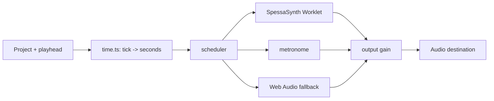

# 时间轴、音频与 MIDI

本文说明 tick/秒/小节的统一换算、播放调度、SoundFont 生命周期和 MIDI Type 1 导出。工程时间事件见 [data-model.md](./data-model.md)，本地资源协议见 [desktop-and-persistence.md](./desktop-and-persistence.md)。

## 1. 单一时间来源

[`src/domain/time.ts`](../src/domain/time.ts) 是时间解释的唯一来源。核心函数包括：

- `ticksPerBeat`
- `buildMeasures`
- `ticksForMeasures`
- `tickToSeconds`
- `secondsToTick`
- `snapTickBackward`
- `snapTickForward`

播放器、播放头动画、循环、节拍器、标尺、工程总小节数和 MIDI 不能各自维护一套近似公式。

固定基准：

```text
PPQ = 960 tick / quarter note
```

但“一拍”取决于拍号分母：

```text
ticksPerBeat = PPQ * 4 / denominator
ticksPerMeasure = ticksPerBeat * numerator
```

例如 6/8 的记谱拍单位与 4/4 不同。节拍器是否按复拍子的大拍分组属于播放策略，但小节边界必须先由 meter 事件准确建立。

## 2. 变速与 tick/秒换算

tempo 事件把时间轴分成多个恒速段。`tickToSeconds` 需要累加目标 tick 之前每一段的持续秒数，再计算所在段的剩余部分。`secondsToTick` 做相反的分段搜索。

```text
tick 0 --120 BPM-- tick A --90 BPM-- tick B
```

不能用“当前 BPM”把整个工程一次相除，否则：

- 从中间开始播放会错位。
- 播放头与实际声音逐渐分离。
- 循环回绕点不准确。
- MIDI 和应用内播放时长不一致。

新增速度曲线前，需要先扩展领域时间模型和双向换算，不应只在 audio scheduler 中插值。

## 3. 变拍号与小节

工程设置以小节数呈现，总长度仍以 `lengthTicks` 持久化。`buildMeasures` 按 meter 事件建立每个小节的开始、结束和拍结构，`ticksForMeasures` 用于把用户输入的小节数转换为工程长度。

变拍号发生在合法小节边界时，后续小节使用新长度。UI 调整总小节数时应：

- 使用当前 meter 事件序列计算目标 tick。
- 检查已有音符、和弦、循环和全局事件是否超出新结尾。
- 明确拒绝或通过领域命令处理，不能只裁剪画布。

标尺刻度和节拍器也应遍历 `buildMeasures` 结果，以确保看到的拍点与听到的点击一致。

## 4. 吸附方向

编辑器需要两个方向明确的函数：

```text
起点/移动位置 -> snapTickBackward
拖拽结束边界 -> snapTickForward
```

向前取整避免点击网格后半段时意外跳到下一格；向后取整保证拖过边界即可获得完整时值。除非某个命令明确要求“最近拍点”，不要使用 `Math.round(tick / grid) * grid`。

## 5. 音频架构

[`src/audio/audioEngine.ts`](../src/audio/audioEngine.ts) 管理 AudioContext、SpessaSynth、预听、播放调度、节拍器和无 SoundFont 回退。工程中的音符保持纯数据，播放时转换为合成事件。



SpessaSynth AudioWorklet 必须显式连接到输出链。成功创建处理器但未连接 destination 会表现为“播放动画正常但完全无声”。

## 6. 初始化与默认音色

应用启动后预载默认 SoundFont，而不是等第一次点击播放。这样可以：

- 第一次画音符就能预听。
- 第一次播放不会因大文件解析产生明显延迟。
- 初始化失败能提前显示并使用回退合成器。

浏览器的自动播放策略可能要求用户手势后才能 `resume()` AudioContext，但资源获取和解析可以提前进行。不要把“Context 尚未允许发声”误判为“应把工程音色重置为默认”。

默认 SoundFont 位于：

```text
public/soundfonts/default.sf2
public/soundfonts/default.sf2.sha256
public/soundfonts/LICENSE-default-soundfont.txt
public/soundfonts/README.md
```

它由 [`scripts/generate-default-soundfont.mjs`](../scripts/generate-default-soundfont.mjs) 使用确定性的数学波形生成，不包含第三方采样，包含程序 52/53。更新脚本后运行：

```powershell
npm run generate:soundfont
```

提交生成文件、哈希、许可证说明和脚本变更，并验证生产资源路径。

## 7. 用户 SoundFont 生命周期

本地 SF2/SF3 的加载跨 renderer 与主进程：

```text
系统对话框选择路径
-> 主进程检查扩展名、大小、位数和可用内存策略
-> 创建 15 分钟短期 token
-> renderer 从 satb-soundfont://resource/<token> 流式读取
-> SHA-256 与读取进度并行
-> 最后一次选择成功后替换合成器
-> release token
```

限制来自 [`electron/soundfont-policy.ts`](../electron/soundfont-policy.ts)：

- 文件硬上限 2 GiB。
- 32 位进程中，超过 512 MiB 明确拒绝。
- 内存预算按 `文件大小 * 1.5 + 512 MiB 系统保留` 估算。

2 GiB 是接收文件的目标上限，不承诺所有机器都能成功解析 2 GiB 音色。SpessaSynth、WASM 地址空间、系统可用内存和 SF2 内部结构都可能成为更早限制。

主进程不把任意本地路径交给 renderer 的 fetch。token 只对应已经验证的文件，15 分钟后过期，加载完成或取消后主动释放。

### 7.1 选择竞争

SoundFont 读取和解析是异步的。`soundFontChangeGeneration` 与串行加载队列保证最后一次用户选择生效：

- 较旧加载即使晚完成，也不能覆盖新选择。
- 点击播放不能重新应用默认音色并覆盖已加载本地音色。
- 失败时保留当前可用合成器，并报告新选择失败。

工程打开时的音色引用、默认预载和用户手动选择都必须经过同一代际判断。

## 8. 回退合成器与预听

无可用 SF2 时，Web Audio 三角波作为可用性回退。它不是最终音色，但应支持：

- 单音符新建预听。
- 单选移动/变调预听。
- 正常播放和停止。

多选移动不触发逐个音符预听，防止声音堆叠。擦除不需要预听。

预听与主播放共享输出资源时要区分事件所有者。暂停播放不应永久破坏之后的编辑预听；重新预听必须能打开正确增益并建立自己的短事件。

## 9. 播放、暂停和循环

播放包含两条并行链：

- 音频 scheduler 根据 tick/秒关系安排未来合成事件。
- 动画根据 AudioContext 时间更新 playhead。

暂停必须同时处理两者。正确暂停包括：

1. 停止动画循环。
2. 取消尚未发生的已调度事件。
3. 调用合成器 `stopAll`。
4. 关闭/归零播放输出增益。
5. 停止回退振荡器。
6. 保留暂停 tick，供继续播放使用。

只停动画会导致“红线不动但声音继续”。只关闭增益而不取消事件会让恢复后旧事件泄漏。

循环范围来自工程 `loop`。scheduler 接近终点时必须在统一时间基准上回绕到起点，并重新安排节拍器和音符。变速区间内的循环不能用固定毫秒长度反复。

## 10. 节拍器

节拍器从 meter 事件的小节/拍点和 tempo 事件的秒位置共同生成。重拍与普通拍可以使用不同音高或增益，但不能另建一个独立计时器按 `60000/BPM` 自由运行，因为：

- 浏览器 timer 会漂移。
- 暂停/恢复和从中间播放难以对齐。
- 变速、变拍号和循环会断开。

应把点击声作为 AudioContext 时间轴上的另一类调度事件，并与主播放一同取消。

## 11. MIDI Type 1 导出

[`src/domain/midi.ts`](../src/domain/midi.ts) 构建结构化事件，`midi-file` 负责序列化。当前只实现导出，尚未实现导入。

导出轨道：

```text
Track 0: tempo + meter + key signature
Track 1-4: soprano / alto / tenor / bass
Track 5...: each auxiliary track
Optional: Chords marker track
```

约定：

- 使用 MIDI Type 1 和工程 PPQ。
- 各 SATB/辅助轨独立，便于 DAW 再编辑。
- 通道分配跳过通道 10（打击乐通道）。
- Note On/Off 按绝对 tick 构造后转为 delta time。
- 全局轨写入 tempo、拍号和调号事件。
- 可选和弦轨写 marker；未标注范围使用 `N.C.` 表达空白。
- 和弦 marker 名称由当前 identity/semantics 计算，而不是保存旧 UI 文案。

辅助轨允许重叠，导出时不能套用 SATB 单声部过滤。音高输出使用 `SpelledPitch` 转换后的 MIDI 数字；MIDI 1.0 普通 Note On 不保留完整等音拼写，因此 `.satb` 仍是可编辑语义的主格式。

## 12. MIDI 导入的未来边界

规划中的导入有两个模式：

- **解析：** 尝试将音符分配到 SATB；失败或有歧义的音符进入额外辅助轨。
- **不解析：** 所有音符进入辅助轨。

无论模式如何，导入不能删除无法解释的音符。实现时需要先扩展领域导入结果和来源字段，再接 UI；解析算法失败不应导致整个 MIDI 文件无法打开。

当前仓库没有 MIDI 导入实现。看到辅助轨模型不应误以为这项交互已经完成。

## 13. 排查顺序

### 播放动画正常但无声

1. AudioContext 是否已 resume。
2. SpessaSynth worklet 是否连接输出。
3. SoundFont 是否完成加载，选择 generation 是否仍为当前。
4. 输出 gain 是否在上次暂停后恢复。
5. 回退合成器是否也无声，以区分资源和输出问题。

### 暂停后仍发声

检查未来事件取消、`stopAll`、gain 和 fallback oscillators，而不只是 animation frame。

### 本地音色播放时回退默认

检查播放初始化是否重复调用默认加载，以及较旧默认 generation 是否覆盖用户 generation。

### 播放头或循环漂移

检查是否有模块绕过 `time.ts` 使用当前 BPM 或固定小节长度；再检查各图层 scroll/origin 是否一致。

## 14. 变更检查表

- tick/秒/小节是否复用 `time.ts`，并覆盖变速和变拍号？
- 播放、动画、循环和节拍器是否使用同一时间原点？
- 暂停是否真正取消声音，暂停后预听是否仍可用？
- 用户 SoundFont 是否不会被默认预载或旧异步结果覆盖？
- 大文件是否仍通过 token 流式读取，并及时 release？
- MIDI 全局事件、轨道 delta time、重叠辅助轨和通道 10 是否正确？
- 新资源是否包含来源、许可证、哈希和生产路径测试？
