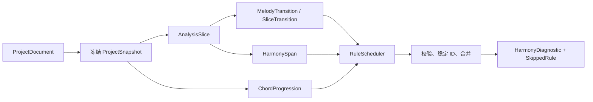

# 和声语义与规则引擎

本文说明内置和声检查从工程快照到诊断的标准处理流程，以及切片、`HarmonySpan` 和规则私有状态的维护方式。音高与和弦持久模型见 [data-model.md](./data-model.md)，外置脚本契约见 [external-rules.md](./external-rules.md)。

## 1. 术语边界

项目曾用“功能分析”泛指和弦用途，但传统和声学中的“功能”本身通常特指 T/S/D 功能体系。为避免歧义，当前文档和代码按以下术语区分：

- **和弦实体（identity）：** 根音、类别、转位和客观构成。
- **和声语义（semantics）：** 调内级数、副属目标、混合、终止角色、人工解释和置信度。
- **功能标记（functional designation）：** 斯波索宾 T/S/D 体系及主次功能亲缘。
- **功能类别（functional class）：** tonic、predominant、dominant 等旧检查器使用的粗粒度兼容分类。
- **语义分析流水线：** 从工程建立上下文并供规则查询的整体过程。

语义字段提供证据，不应成为互相覆盖的单一“最终标签”。规则需要明确声明自己依赖哪些字段，在歧义时跳过或降低置信度。

## 2. 总体流水线



源码入口：

- [`harmonyAnalysis.ts`](../src/domain/harmonyAnalysis.ts)：快照、切片、转换、跨度和查询。
- [`harmonyRuntime.ts`](../src/domain/harmonyRuntime.ts)：规则定义、状态信封、调度和诊断收敛。
- [`harmonyRules.ts`](../src/domain/harmonyRules.ts)：规则目录与内置实现。
- [`externalRules.ts`](../src/domain/externalRules.ts)：裁剪后的外置上下文与边界验证。

分析输入是指定 revision 的不可变工程快照。规则不得修复、标注或修改工程，只能返回诊断或结构化跳过原因。

## 3. `AnalysisSlice`

切片是“在一段连续时间内，SATB 活跃音符、调号和和弦上下文不变”的最小分析单位。边界通常来自：

- 任一 SATB 音符开始或结束。
- 和弦区域开始或结束。
- 调号变化。
- 工程起止。

每个切片包含：

```ts
interface AnalysisSlice {
  index: number;
  tick: number;
  endTick: number;
  notes: Partial<Record<VoiceId, AnalysisNote>>;
  attackVoiceIds: VoiceId[];
  key: AnalysisKey;
  chord?: AnalysisChord;
  completeSatb: boolean;
  continuity: "continuous" | "project-start";
}
```

`attackVoiceIds` 区分本切片真正起奏的声部和从前一切片延续的音符。这个区别对平行进行、延迟解决和声切分非常重要：切片变化不一定代表四个声部都产生了新动作。

切片是有序数组，前后关系是链式可遍历的，不局限于只看相邻一项。查询 API 包括：

- `previousSlice` / `nextSlice`
- `walkSlices`
- `previousAttack` / `nextAttack`

需要跨多个切片寻找下一次真实起奏时，应调用 attack 查询，而不是简单使用 `sliceIndex + 1`。

## 4. 转换视图

为了避免每条规则重复拼接上下文，分析层预先建立三种转换。

### 4.1 `MelodyTransition`

按声部连接相邻音符，提供：

- 前后音符和声部。
- 时间是否连续。
- 调号是否相同。
- 是否仍属同一和声。
- 使用书写拼写计算的音程。

旋律跳进、增减音程、导音解决等规则优先使用它。

### 4.2 `SliceTransition`

连接相邻切片，记录连续性、调号、同和声判断和实际变化的声部。平行五/八度、隐伏进行、声部超越等需要同时观察多个声部的规则使用它。

### 4.3 `ChordProgression`

连接相邻和弦区域，提供前后和弦、连续性、调号、同和声判断和旧功能类别。当前逆功能进行、副属目标和终止四六仍使用该兼容视图；新斯波索宾 designation 尚未接入连接规则。

转换对象不是新的持久化事实，只是从当前工程快照计算的索引。

## 5. `HarmonySpan`

连续同和弦转换不能把每个和弦区域都当成独立功能事件。例如同一主和弦在多个转位、旋律位置和排列中连续变化时，导音或七音可能在整个同和弦段结束后才解决。

`HarmonySpan` 将满足以下条件的相邻和弦区域聚合：

- 时间连续。
- 调号相同。
- 和弦实体构成相同；低音/转位变化不单独切断跨度。
- 完整语义上下文相同，包括所有确认解释、目标、借用、四六角色与持续低音。

主要字段：

```ts
interface HarmonySpan {
  id: string;
  fromTick: number;
  toTick: number;
  regionIds: string[];
  sliceIndices: number[];
  identityKey: string;
  semantics?: HarmonySemantics;
  functionalClass: FunctionalClass;
  status: "complete" | "ambiguous";
  entryTransitionIndex?: number;
  exitTransitionIndex?: number;
}
```

查询 API：

- `harmonySpanAtTick`
- `harmonySpanAtSlice`
- `walkSpans`

由此，规则可以选择合适尺度：静态音域看一个切片，连续同和弦解决看一个 span，和声切分或长程目标可以跨多个 span。

### 5.1 为什么不只比较显示名称

罗马数字文本可能因本地调性、人工标注或显示模式不同而改变，也可能掩盖转位和拼写差异。跨度使用标准化 identity/semantics 键比较，不能用 UI 标签相等代替。

### 5.2 何时必须切断

调号改变、实体构成改变、语义目标改变、时间不连续或语义从确定变为歧义时需要切断。若未来增加临时化和弦音，应明确它属于构成变化还是音符角色，不能为通过个别规则随意扩大 span。

### 5.3 当前功能体系兼容边界

本轮只升级数据、编辑与显示。旧检查器遇到 D9、增六和弦、双解释共同和弦或持续低音上下文时跳过其无法可靠理解的和弦规则，不把粗粒度 `FunctionalClass` 当成新语义。下一轮规则重构应直接消费精确 interpretation/designation/target，并删除临时 legacy projection。

## 6. 规则私有状态 `RuleStateEnvelope`

有些判断在创建证据时还不能得出结果，例如导音、和弦七音、副属目标和挂留音。引擎提供一个规则私有、沿切片链传递的 JSON 容器：

```ts
interface RuleStateEnvelope<T extends JsonValue = JsonValue> {
  id: string;
  ownerRuleId: string;
  createdAt: { tick: number; sliceIndex: number };
  subjectRefs?: {
    voiceIds?: VoiceId[];
    noteIds?: string[];
    chordIds?: string[];
    spanIds?: string[];
  };
  payload: T;
}
```

核心只处理横向传递和安全约束：

- `ownerRuleId` 必须是当前规则，规则之间不能共享可变状态。
- 创建位置和引用必须指向当前分析中存在的对象。
- 每条规则最多保留 512 个状态。
- 单个 payload JSON 序列化后最多 16 KiB。
- payload 必须是 JSON 值，不能包含函数、循环引用或运行时对象。

核心**不解释** payload 是导音、七音或什么“义务”，也不规定统一 deadline/status。具体规则决定：

- 何时创建状态。
- 同和弦转换时继续保留还是更新。
- 哪个后续起奏满足条件。
- 遇到休止、换调、span 退出或工程结束时如何结束。
- 是发出诊断、结构化 skip，还是继续等待。

这种设计让状态容器保持通用，避免一套僵硬的 `ResolutionObligation` 枚举限制未来规则，同时仍提供统一的隔离、引用和资源上限。

## 7. 有状态规则调度

有状态规则实现：

```ts
process(step, incoming, config) -> diagnostics + skipped + outgoing
finalize?(lastStep, remaining, config) -> diagnostics + skipped
```

每个 `RuleStepContext` 提供当前切片、前一切片、转换、当前 span，以及是否为 span 起止。标准流程：

1. 调度器按切片顺序调用 `process`。
2. 仅把该规则上一步输出作为下一步 `incoming`。
3. 校验 outgoing 所有者、引用、数量与 payload 大小。
4. 工程结束后调用 `finalize` 处理未决状态。

当前使用状态信封的内置规则：

- `leading-tone-resolution`
- `chord-seventh-resolution`
- `secondary-dominant-resolution`

导音和七音的证据链在声部休止时中断。不能穿过休止把更远的音误当成解决。同和弦 span 内的转换则可以延迟判定，直到真正离开该和声。

## 8. 规则需求与结构化跳过

每条规则定义 `requires` 和 `dependencyScope`。

可用需求包括书写音高、和弦、完整 SATB 和语义等。调度器和规则据此区分“没有错误”与“无法判断”。无法判断时返回：

```ts
type RuleSkipReason =
  | "no-chords"
  | "missing-semantics"
  | "ambiguous-semantics"
  | "insufficient-context"
  | "rule-error";
```

skip 的意义：

- 没有和弦轨时，依赖和弦的规则不是自动通过。
- 人工/自动语义有歧义时，不能武断发出功能进行错误。
- 工程结尾无法观察解决时，可以标为上下文不足或由规则明确决定。
- 某条规则异常不应让全部检查失败。

`partial` 表示规则只完成了部分范围的判断。UI 可以用它解释覆盖不足，不能把 skip 伪装成普通诊断。

## 9. 诊断契约

规则返回的诊断经 runtime 验证后形成：

```ts
interface HarmonyDiagnostic {
  id: string;
  ruleId: string;
  source: "builtin" | "external";
  severity: "error" | "warning" | "suggestion";
  tick: number;
  endTick: number;
  voiceIds: VoiceId[];
  noteIds: string[];
  chordIds: string[];
  title: string;
  message: string;
  messageKey: string;
  params: Record<string, string | number | boolean>;
  evidence: DiagnosticEvidence[];
  confidence: number;
}
```

维护约束：

- 单规则最多 512 项诊断。
- 消息最多 600 字，evidence 最多 16 项。
- 所有 tick 范围和对象引用必须有效。
- 稳定 ID 由 rule/messageKey/tick 和排序后的对象引用生成。
- 同一根因的连续范围在收敛阶段合并。
- 诊断严重程度来自工程规则配置，规则实现不应硬编码用户选择。

和弦整体错误应引用 `chordIds`，不要为了显示方便复制到范围内每个音符。例如“和弦构成音不完整”只标注和弦区域。真正涉及单个声部时才填写 note/voice 引用。悬停 UI 会按引用聚合一个对象上的全部诊断。

## 10. 内置规则目录

规则目录以 [`HARMONY_RULE_DEFINITIONS`](../src/domain/harmonyRules.ts) 为唯一来源。下表记录当前契约；默认严重程度可以在设置中改为 `off`。

### 10.1 声部与音域

| ID | 默认 | 依赖 | 范围 | 作用 |
| --- | --- | --- | --- | --- |
| `voice-range` | warning | written-pitches | note | 检查各声部建议音域 |
| `voice-note-overlap` | error | written-pitches | note | 检查同一 SATB 声部同时发出多个音高 |
| `voice-crossing` | error | written-pitches | slice | 检查相邻声部的静态交叉 |
| `upper-spacing` | warning | written-pitches | slice | 检查 S-A、A-T 是否超过八度 |
| `voice-overlap` | warning | written-pitches | slice | 检查进入相邻声部前一位置；同和弦转换放宽 |

### 10.2 旋律进行

| ID | 默认 | 依赖 | 范围 | 作用 |
| --- | --- | --- | --- | --- |
| `melodic-leap-over-octave` | error | written-pitches | note | 检查超过八度的跳进 |
| `melodic-large-leap` | warning | written-pitches | note | 检查不同和弦间大于纯五度且不超过八度的跳进 |
| `melodic-tritone` | warning | written-pitches | note | 检查不同和弦间三全音跳进 |
| `leading-tone-resolution` | warning | written-pitches | note | 越过同和弦延续跟踪导音是否上行解决 |
| `augmented-diminished-interval` | warning | written-pitches | note | 按书写音程检查增减音程，并放宽同和弦分解跳进 |

### 10.3 声部间进行

| ID | 默认 | 依赖 | 范围 | 作用 |
| --- | --- | --- | --- | --- |
| `cross-relation` | suggestion | written-pitches | phrase | 检查相邻窗口的同时或先后对斜 |
| `parallel-fifths` | error | written-pitches | slice | 检查同向连续纯五度 |
| `parallel-octaves` | error | written-pitches | slice | 检查同向连续八度或同度 |
| `hidden-perfect-interval` | warning | written-pitches | slice | 检查不同和弦间外声部同向跳到纯五/八度 |

### 10.4 和弦与功能

| ID | 默认 | 依赖 | 范围 | 作用 |
| --- | --- | --- | --- | --- |
| `chord-membership` | warning | written-pitches, chords | chord | 检查未人工标注角色的和弦外音 |
| `chord-completeness` | warning | written-pitches, chords, complete-satb | chord | 在同和弦转换结束处检查构成音完整性 |
| `chord-inversion` | error | written-pitches, chords | chord | 检查男低音与转位标记 |
| `leading-tone-doubling` | error | written-pitches, chords, complete-satb | chord | 在 span 结束处检查重复调内导音 |
| `chord-seventh-resolution` | warning | written-pitches, chords | phrase | 跟踪七音是否级进下行解决 |
| `chord-seventh-doubling` | error | written-pitches, chords, complete-satb | chord | 在 span 结束处检查重复和弦七音 |
| `functional-retrogression` | warning | chords, semantics | phrase | 检查斯波索宾基础序进中的 D -> S |
| `secondary-dominant-resolution` | warning | chords, semantics | phrase | 跟踪副属和弦是否进入标注目标 |
| `cadential64-resolution` | warning | chords, semantics | phrase | 检查终止四六是否连续进入属功能和弦 |

## 11. 同和弦转换中的规则策略

同和弦转换允许放宽部分不同和弦连接规则，但不是取消全部声部规范。当前规则体系按 `sameHarmony` 和 `HarmonySpan` 处理：

通常放宽：

- 较大旋律跳进和分解和弦式连续跳进。
- 隐伏五度/八度。
- 声部超越。
- span 中间切片的构成音完整、导音/七音重复等暂时状态。
- 导音、七音等解决义务延迟到真正离开 span 后判断。

仍然检查：

- 平行纯五度和八度/同度。
- 同一切片的声部交叉。
- 声部音域。
- 上三声部静态间距。

当规则新增“同和弦例外”时，应复用 `sameHarmony`/span，而不是在每条规则用罗马数字字符串做不同版本的比较。

## 12. 增量分析与失效范围

`HarmonyAnalysis` 带有 `invalidationRanges`，范围同时标记 note/slice/chord/phrase/project 等依赖尺度。它用于表达一次编辑可能影响哪些规则上下文。

当前实现仍应优先保证完整结果正确；优化为真正局部重算时，需要考虑：

- 音符边界变化会重建附近切片。
- 和弦 identity/semantics 变化可能合并或拆分 span。
- 有状态规则的影响可能从编辑点延伸到状态解决、失效或工程末尾。
- 调号变化会影响之后的拼写解释和和弦语义。

不能只重算几何重叠范围。跨切片状态必须从一个确定的无状态边界重新开始，或携带可验证的缓存快照。

## 13. 新增内置规则流程

1. 明确规则判断的是静态事实、相邻转换、span 还是长程链。
2. 确定依赖：written-pitches、chords、complete-satb、semantics。
3. 确定 `dependencyScope`，供跳过和未来增量调度使用。
4. 在 `HARMONY_RULE_DEFINITIONS` 增加 ID、标签、默认严重度和说明。
5. 无需跨步时实现 `evaluate`；需要等待后文时实现 `process/finalize` 和私有 payload。
6. 对缺少和弦、语义歧义、休止、工程结尾和调号变化给出明确策略。
7. 返回准确对象引用、稳定 `messageKey`、结构化 params/evidence 和置信度。
8. 添加正例、反例、同和弦例外、边界和 revision 测试。
9. 更新本规则表和设置页（设置页应从定义生成）。

## 14. 常见误判来源

- 把相邻切片当成相邻起奏，导致延续音被视为新进行。
- 用 MIDI 半音数代替书写音程，无法区分增四与减五。
- 用单个和弦区域判断解决，忽略连续同和弦转换。
- 穿过休止继续寻找导音/七音解决。
- 把语义缺失当成默认 T/S/D，制造逆功能误报。
- 把一个和弦整体错误附到四个音符，导致 UI 重复报告。
- 外置或异步旧 revision 返回后覆盖当前结果。
- 为某个测试特例扩宽全局 span 定义，意外压制其他规则。

修复规则时应先确认错误发生在模型、切片、语义、规则状态还是诊断归属层，不要只在最终消息生成处加例外。
