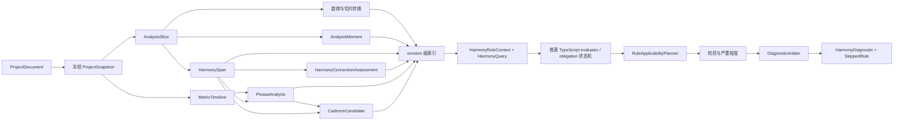

# 和声语义与规则引擎

本文说明内置和声检查从工程快照到最终诊断的标准处理流程，以及切片、`HarmonySpan`、精确连接、规则私有状态、适用性和诊断仲裁的职责边界。音高与和弦持久化模型见 [data-model.md](./data-model.md)，外置脚本契约见 [external-rules.md](./external-rules.md)。

## 1. 术语边界

传统和声中的“功能”特指 T/S/D 功能体系。代码中不再用“功能分析”泛指和弦用途，也不保留粗粒度 `FunctionalClass` 兼容层：

- **和弦实体（identity）：** 根音、结构、构成音、低音与转位。
- **和声语义（semantics）：** 局部调性、级数、离调目标、混合、终止角色、持续低音和一个或两个解释。
- **功能标记（functional designation）：** 斯波索宾 T/S/D 体系的结构化标记。
- **跨度（span）：** 连续且实体、调性和语义相同的一段和声。
- **连接（connection）：** 相邻 span 之间基于精确解释得到的关系和证据。
- **适用性（applicability）：** 某条规则面对本次上下文时应严格执行、降级、豁免或延后。

语义字段是证据，不是互相覆盖的单一最终标签。规则必须声明依赖，面对缺失或歧义时保守处理。

## 2. 总体流水线



主要源码入口：

- [`harmony/analysis.ts`](../src/domain/harmony/analysis.ts)：冻结快照、切片、转换、span、索引和失效范围。
- [`rhythm/metric.ts`](../src/domain/rhythm/metric.ts)：节拍层级与强弱位置，供乐句、终止式和规则共用。
- [`harmony/phrase`](../src/domain/harmony/phrase)：乐句边界候选、结构模板与分段。
- [`harmony/cadence`](../src/domain/harmony/cadence)：乐句末端终止式候选检测。
- [`harmony/inference`](../src/domain/harmony/inference)：自动和弦推导与写回，见 [analysis-inference.md](./analysis-inference.md)。
- [`harmony/rules/sharedFacts.ts`](../src/domain/harmony/rules/sharedFacts.ts)：书写音程、声部对、低音运动和和弦成员事实。
- [`harmony/rules/context`](../src/domain/harmony/rules/context)：revision 级索引、领域视图和统一对象导航。
- [`harmony/rules/query/HarmonyQuery.ts`](../src/domain/harmony/rules/query/HarmonyQuery.ts)：保序、不可变的通用集合查询算子。
- [`harmony/rules/services`](../src/domain/harmony/rules/services)：面向规则上下文装配音高、节拍、和声和声部进行能力。
- [`harmony/rules/state`](../src/domain/harmony/rules/state)：普通 TypeScript obligation 状态负载、时间点和倾向音来源定义。
- [`harmony/rules/diagnostics/factory.ts`](../src/domain/harmony/rules/diagnostics/factory.ts)：从领域视图构造稳定诊断引用。
- [`harmony/rules/connector.ts`](../src/domain/harmony/rules/connector.ts)：精确 span 连接。
- [`harmony/runtime.ts`](../src/domain/harmony/runtime.ts)：无状态/有状态规则调度与结果收敛。
- [`harmony/rules/applicability.ts`](../src/domain/harmony/rules/applicability.ts)：特例上下文折叠。
- [`harmony/rules/diagnosticArbiter.ts`](../src/domain/harmony/rules/diagnosticArbiter.ts)：稳定根因键、合并与父子覆盖。
- [`harmony/registry.ts`](../src/domain/harmony/registry.ts)：内置规则的调度与运行入口。每个 `rules/groups/*.ts` 文件在算法之后声明完整规则对象，由 `rules/groups/index.ts` 按组汇总；构造、重复检查和完整性校验位于 `rules/defineRule.ts`。
- [`harmony/rules/types.ts`](../src/domain/harmony/rules/types.ts)：不依赖规则实现的纯类型契约；`rules/catalog.ts` 从可执行规则集合派生目录与默认配置公共 API。
- [`harmony/rules/catalog.ts`](../src/domain/harmony/rules/catalog.ts)：81 条规则目录、配置声明和实现状态。

分析输入是指定 revision 的不可变快照。规则不得修改工程，只能返回原始诊断或结构化 skip。

## 3. 时间切片

`AnalysisSlice` 是一段 SATB 活跃音符、调号和和弦上下文均不变化的半开时间区间：

```ts
interface AnalysisSlice {
  index: number;
  tick: number;
  endTick: number;
  notes: Partial<Record<VoiceId, AnalysisNote>>;
  attackVoiceIds: readonly VoiceId[];
  key: AnalysisKey;
  chord?: AnalysisChord;
  completeSatb: boolean;
  continuity: "continuous" | "project-start";
}
```

边界来自 SATB 音符起止、和弦区域起止、调号变化和工程起止。切片反映持续状态，`attackVoiceIds` 区分本 tick 新起奏与延音；规则不能把每个切片都当成新音。

`MelodyTransition` 连接同一声部的连续起奏音，包含休止连续性、调性/和声是否相同及书写音程。`SliceTransition` 连接相邻切片，记录变化声部、连续性和上下文关系。

## 4. HarmonySpan

多个相邻和弦区域满足以下条件时聚合为一个 span：

- 时间首尾相接；
- 局部调性相同；
- 忽略低音后仍为同一和弦实体；
- 和声语义上下文一致。

```ts
interface HarmonySpan {
  id: string;
  fromTick: number;
  toTick: number;
  regionIds: readonly string[];
  sliceIndices: readonly number[];
  identityKey: string;
  semantics?: HarmonySemantics;
  status: "complete" | "ambiguous";
  entryTransitionIndex?: number;
  exitTransitionIndex?: number;
}
```

这使一个、两个或任意多个连续同和弦转换拥有同一处理方式。休止、时间缺口、调性变化、实体变化或语义解释变化都会断开 span。`sliceSpanIds` 和 `chordSpanIds` 提供稳定查询，规则不应自行按显示名称重新聚合。

span 只表达区段事实，不承担“导音必须上行”等规则结论。解决要求属于具体规则的私有状态。

## 5. 精确和弦连接

`buildHarmonyConnections` 只连接时间顺序相邻的 span，并产生：

```ts
interface HarmonyConnectionAssessment {
  connectionKey: string;
  previousSpanId: string;
  currentSpanId: string;
  previousInterpretationId?: string;
  currentInterpretationId?: string;
  relation:
    | "same-harmony"
    | "tonic-departure"
    | "predominant-to-dominant"
    | "dominant-to-tonic"
    | "deceptive"
    | "applied-target"
    | "double-dominant-target"
    | "cadential64-target"
    | "retrogression"
    | "pivot-reinterpretation"
    | "unknown";
  contiguous: boolean;
  sameKey: boolean;
  targetMatched?: boolean;
  evidence: readonly ConnectionEvidence[];
  confidence: "certain" | "probable" | "ambiguous" | "unknown";
}
```

连接器读取主要 `HarmonyInterpretation`、`FunctionalDesignation`、离调目标、终止角色和持续低音上下文。它可以判断 D 到 T、S 到 D、离调属目标、重属目标、K46 目标、阻碍进行、逆功能进行和共同和弦重新解释。

连接器提供“发生了什么”的结构化事实，不决定某一规则是否报警。不同教材口径通过规则严重程度、配置和特例策略表达，不能重新引入一个粗粒度枚举替代精确解释。

副属与重属目标还会展开为 `FunctionalTargetChainFact`。目标链沿连续 span 前进，允许指向属功能的目标经过 `K46`，并明确区分 `matched`、`violated` 与 `deferred`；休止、转调或语义歧义不会被强行判成失败。

## 6. 查询上下文与共享事实

详细算子契约、空集合语义和 revision 边界见 [harmony-query.md](./harmony-query.md)。

`HarmonyRuleContext` 是规则跨对象查找的统一入口。规则通过 `notes()`、`slices()`、`spans()`、`connections()`、`melodyTransitions()`、`sliceTransitions()`、`phrases()` 和 `cadences()` 取得稳定视图，通过 `sliceAt()`、`spanAt()`、`keyAt()`、`noteNeighborhood()`、`spanNeighborhood()`、`phraseAt()`、`boundaryAt()` 与 `cadenceAt()` 完成定位和相邻导航。入口选项只承担可命中索引的粗筛选，复杂条件使用 `HarmonyQuery.where()` 和普通 TypeScript 控制流表达。

`HarmonyQuery` 保留完整的通用算子集合，包括筛选、投影、展开、相邻对、滑动窗口、前缀截取、稳定去重、稳定排序、分组、量词和定位。每个中间算子返回新的只读查询快照；规则可以保留有意义的局部变量、分支和提前退出，不要求把完整判断压入查询链。

跨规则重复使用且已经稳定的低层计算继续集中提供：

- `voicePairTransitionFacts`：六组声部对的前后书写音程、上下运动、同向性、外/内声部身份和低音运动。
- `bassMotionFact`：按字母级数与实际方向区分上行级进、下行级进、保持和其他运动。
- `chordMemberFacts`：每个活跃音符是否属于当前 `ChordIdentity`，以及对应构成音索引。
- `HarmonyContextFacts`：同和弦、分解和弦、声部交换、内声部、低音上行级进、已标注非和弦音、持续低音、终止与转调连接的稳定 ID 集合。

稳定音乐学计算属于 `domain/pitch`、`domain/chordModel`、`domain/functionalHarmonyCatalog`、`domain/time` 和 `domain/rhythm/metric` 等领域模块；`rules/services` 只负责把分析视图适配到这些能力，不复制公式。只服务单条规则的教材政策和特例保留在规则文件附近，不伪装成通用事实。

平行五八度、不等五度、隐伏进行和对斜等规则必须共享书写音高口径，避免各自按 MIDI 半音重新推导而产生互相矛盾的结果。

## 7. 规则目录与实现

规则源码是目录的唯一事实来源。每条内置规则在所属 `rules/groups/*.ts` 文件末尾以 `defineStatelessRule` 或 `defineObligationRule` 声明完整对象；复杂规则仍使用具名的普通 TypeScript evaluator。单个对象同时包含稳定 ID、目录号、说明、理由、分组、默认严重程度、依赖、配置、特例、覆盖关系和执行定义。`rules/catalog.ts` 只从完整规则集合派生有序目录、ID 索引和设置界面所需投影；规则金样本与工作台见 [rule-testing.md](./rule-testing.md)。

每条无状态规则直接引用一个具名 evaluator。相近规则可以共享事实提取、遍历原语或类型化策略内核，但不能把 `ruleId` 作为行为分支；规则 ID 在公共辅助函数中只允许作为诊断归属数据。这样规则对象、算法入口和测试目标保持一一对应。

当前内置规则均有可执行实现并进入调度。规则是否产生诊断仍取决于工程严重程度、配置、适用性策略和结构化上下文；缺少人工非和弦音角色、终止类型、局部调性或双重解释时，相关规则保持静默或返回 skip，不使用启发式猜测补齐语意。

## 8. 规则私有状态

底层跨切片协议仍使用通用 `RuleStateEnvelope`：

```ts
interface RuleStateEnvelope<T extends JsonValue = JsonValue> {
  id: string;
  ownerRuleId: string;
  createdAt: { tick: number; sliceIndex: number };
  subjectRefs: {
    voiceIds: readonly VoiceId[];
    noteIds: readonly string[];
    chordIds: readonly string[];
    spanIds: readonly string[];
  };
  payload: T;
}
```

每条规则只能读取并返回自己的状态。`payload` 是纯 JSON；宿主校验所有权、引用、时间、数量和大小。跨时间义务使用 `defineObligationRule`，由 obligation 运行时统一管理信封、分区、去重、重触发和最小轨迹。

义务规则显式声明普通 TypeScript 回调：

- `source`：从当前 `AnalysisMoment` 提取开启候选；
- `partitionKey`：确定同一项音乐义务；
- `retrigger`：重复触发时保留、刷新、分叉或拒绝；
- `transition`：根据当前环境产生 continue、resolve、violate、cancel 或 indeterminate；
- `onUnknown/onEnd`：上下文不足和工程结束策略；
- `reportViolation`：只负责该规则的诊断文案。

转移函数按音乐推理顺序使用局部变量和条件分支；上下文不足必须显式返回 indeterminate、continue 或 cancel，不能机械落入违规分支。需要解释时，规则主动附加领域化 trace，而不是依赖通用 AST 生成执行轨迹。

obligation 运行时的典型流程是：

```text
process 当前 step
-> 检查 incoming
-> 满足、保留或报告后删除
-> 根据当前证据创建 outgoing
-> 工程末尾由 finalize 处理剩余状态
```

导音、七音、属九音和方向性变化音已经迁移到义务运行时。导音连续性按声部、来源 span、书写音高、来源调性和固定解决目标判断，因此 `V -> V7` 的实体变化不会自动结算重复导音；七音、九音和变化音当前仍通过具名事实显式采用各自的来源 span 结算口径。

## 9. 适用性计划

规则定义只声明自己支持哪些 context。`planRuleApplicability` 根据诊断对象引用、时间范围与宿主生成的 `HarmonyContextFacts` 计算本次 context，再将目录默认策略和工程覆盖折叠为：

- `strict`：正常报告；
- `downgraded`：严重程度降低一级；
- `skip`：按明确豁免不报告；
- `deferred`：上下文不足或歧义无法形成可靠结论。

内置规则不能在诊断中自行注入公共 context；外置规则也只能读取宿主事实。`same-harmony`、`voice-exchange`、`bass-step-up`、`pedal-point` 或 `modulation` 不会成为全局万能豁免，只有具体规则声明支持后才生效。尚无事实生产者的 `sequence` 不会出现在规则配置项中。

## 10. 校验与诊断仲裁

原始诊断先验证范围、对象引用、消息、置信度和证据，再由宿主注入工程严重程度并生成稳定根因键。最终仲裁包含：

1. 同规则、同根因、同对象且时间相接的诊断合并为范围。
2. 专用规则可声明多个 `coveredRuleIds`；只有结构化 `causeRefs/coverageRefs` 匹配或严格对象集合相同时才覆盖通用诊断。
3. 结果按时间、严重程度和稳定 ID 排序，规则注册顺序不影响输出。

稳定根因键优先使用结构化 `causeRefs`，并结合规则 ID、规范对象范围、时间与 `rootCauseKey/messageKey`。自然语言消息不应承担去重身份。外置诊断在内置仲裁结束后合并，且不能声明 `coverageRefs`，因此不能隐藏内置诊断。

和弦整体问题必须归属 `chordIds`，避免在四个音符上重复显示；旋律和声部进行问题才归属对应音符。诊断可额外提供 `subjects.origin/failure/context` 与最小 `trace`：公共 `noteIds/chordIds` 继续参与仲裁和选择，钢琴卷帘优先只在 failure 对象上绘制警示标记，避免把来源证据显示成第二次报错。

## 11. 工程 RuleProfile

规则设置是工程数据，而不是应用 localStorage 中的运行时真相源：

```ts
interface RuleProfile {
  profileVersion: 2;
  catalogRevision: 2;
  title: string;
  shared: SharedHarmonySettings;
  builtin: Record<string, RuleInstanceSettings>;
  external: ExternalRuleReferenceV3[];
}
```

每个规则实例保存 `severity`、`configVersion`、规范化配置和特例覆盖。`shared` 当前包含四声部建议音域及严格四声部织体开关。工程历史提交负责撤销/重做，保存与恢复直接持久化完整 profile。

应用级 localStorage 只保存“新建工程默认模板”，不会静默覆盖当前工程。`.satb-rule-profile.json` 用于便携导入导出：导出展开所有已知内置规则；导入报告新增、变化、移除、未知规则、缺失外置包和修复键，并通过一次历史提交应用。

## 12. 运行与并发

候选生成、写回和缓存的完整生命周期见 [analysis-lifecycle.md](./analysis-lifecycle.md)；诊断结构和复制报告见 [diagnostics-and-debugging.md](./diagnostics-and-debugging.md)。

内置分析与外置规则请求都携带 revision。旧请求晚返回时标记为 superseded，不能覆盖新工程结果。外置脚本在 Worker + QuickJS 中隔离；其失败记录在独立 failure 列表，不能清空内置诊断。

`RuleScheduler.prepareAnalysis` 使用不含规则 profile 的音乐签名缓存分析快照。分析快照除 slices、spans、connections 和共享事实外，还包含 `metricTimeline`、乐句分段与终止式候选。只修改规则严重程度、配置或特例时，调度器复用已有分析并只重跑签名发生变化的规则；最终诊断仍统一经过仲裁。音乐事件变化时继续由 `AnalysisInvalidationRange` 记录受影响 tick 与依赖 scope，并禁止复用旧规则结果。

5,000 音符工程的单规则配置变更基准已达到 100 ms 目标；本地 Electron 生产构建 E2E 已覆盖规则设置、外置 API v3、恢复、播放、SoundFont、保存和 MIDI。NSIS 安装后 E2E 尚未执行，因此不能据此宣称安装包验收完成。

## 13. 新增规则流程

1. 在设计清单中确定稳定目录号、ID、默认严重程度、规则口径和反例。
2. 优先从领域模块、`HarmonyRuleContext` 和 `rules/services` 选择稳定能力；重复的底层导航或音乐关系先下沉到其唯一所有者，不能通过 `ruleId` 分支复用规则入口。
3. 局部判断使用具名 evaluator 与 `defineStatelessRule`；跨时间结论使用 `defineObligationRule` 和普通 TypeScript 转移函数。
4. 在同一个 `rules/groups/*.ts` 文件末尾声明完整规则对象，包括 options、依赖、覆盖关系和特例 context。
5. 将规则对象加入该文件导出的规则组；只有新增组文件时才修改 `rules/groups/index.ts`。
6. 不在 `catalog.ts` 或 `registry.ts` 重复维护 ID、元数据或 evaluator 表。
7. 让诊断引用正确对象，提供稳定 messageKey/rootCauseKey、origin/failure 分层和结构化证据。
8. 加入最小违规、合法邻例、同和弦、大小调、书写等音、歧义、配置和变形测试；义务规则必须覆盖每个状态原因。
9. 新规则必须同时提交完整规则对象、执行定义和对应场景测试；不存在只有目录项而没有实现的内置规则状态。

## 14. 当前完成边界

规则目录、完整工程 profile、共享事实、span、目标链、连接器、适用性、多规则覆盖仲裁、设置页、分析复用和外置 API v3 已落地。节拍层级、乐句边界、终止式检测与自动和弦推导也已接入分析快照与规则上下文（见 [analysis-inference.md](./analysis-inference.md)）。全部内置规则均由组文件中的完整规则对象定义并具有可执行实现。revision 级 `HarmonyRuleContext`、`HarmonyQuery`、领域服务、`DiagnosticFactory` 和 `obligation-v2` 状态模型已经替换旧声明式 AST、`FactStore`、决策表与兼容定义器；四条倾向音解决规则使用共享 obligation 运行时和各自的普通转移函数。

首版实现遵循保守判断：非和弦音只验证人工角色；终止规则只消费乐句级 `cadenceAnnotations`（或明确的终止式候选）；转调规则只消费连续局部调性、双重解释或人工确认冲突；专用连接规则只在明确功能和连续 span 上执行。教材例题校准不足的规则仍可能需要调整阈值或细化转位口径，但不会用缺失上下文伪造确定结论。
