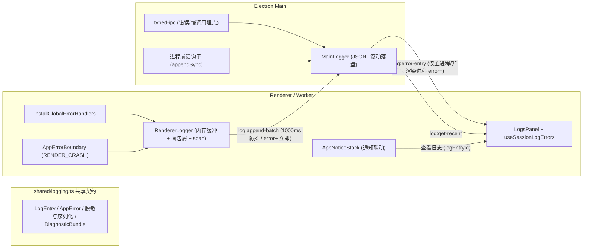

# 运行时日志与可观测性

本文说明 SATB Master 的双进程结构化日志体系、IPC 埋点、渲染崩溃兜底、操作通知联动、底部「日志」工作台、脱敏排错包以及自动化日志门禁。

> **边界区分：** 本系统记录的是**应用运行时行为与故障证据**（`LogEntry` / `DiagnosticBundle` / `schemaVersion: 1`），用于排查文件读写、音频/SoundFont、外置沙箱、IPC 超时、渲染崩溃等工程问题；面向四部和声写作的**音乐学规则诊断**（`HarmonyDiagnostic` / `satb-diagnostic-debug/v1`）见 [diagnostics-and-debugging.md](./diagnostics-and-debugging.md)。

## 1. 定位与分层

SATB Master 为离线桌面应用，问题复现与排查依赖本地可观测性。运行时可观测性按进程与职责分为四层：



关键边界约束：

- **领域层零日志依赖：** `src/domain` 保持纯计算，禁止导入 `services/logging`（由 [`electron/architecture-boundaries.test.ts`](../electron/architecture-boundaries.test.ts) 静态强制）。需要记录耗时或失败时，由控制器或服务层在边界通过 `logger.span()` 包裹。
- **日志链路自身静默降级：** 写盘失败、IPC 断开、窗口已销毁或订阅者抛出异常时，日志系统不得反向触发新的错误循环。
- **单会话标识贯通：** 主进程启动时生成 `sessionId`（UUID），通过 BrowserWindow `additionalArguments`（`--satb-log-session=<id>`）传入 preload，并暴露为 `window.desktop.log.sessionId`，确保排错包与主进程日志文件对应同一运行会话。

## 2. 共享日志契约（`shared/logging.ts`）

[`shared/logging.ts`](../shared/logging.ts) 是主进程与渲染进程共同依赖的无副作用纯 TypeScript 模块。

### 2.1 级别、模块与进程分类

- **5 级 `LogLevel`：** `"debug" | "info" | "warn" | "error" | "fatal"`。辅助函数 `isErrorLog(level)` 判断 `error` / `fatal`。
- **10 个 `LogScope`：** `"app" | "ipc" | "file" | "editor" | "audio" | "harmony" | "inference" | "harmonization" | "external-rule" | "ui"`。
- **3 类 `LogProcess`：** `"main" | "renderer" | "worker"`。

### 2.2 15 个统一错误码（`AppErrorCode`）与 `AppError`

| 分组 | 错误码 |
| --- | --- |
| 通用与跨进程 | `UNKNOWN`、`IPC_FAILED` |
| 文件与恢复 | `FILE_READ_FAILED`、`FILE_WRITE_FAILED`、`PROJECT_INVALID`、`RECOVERY_FAILED` |
| 音频与回放 | `SOUNDFONT_LOAD_FAILED`、`AUDIO_PLAYBACK_FAILED` |
| 和声与辅助写作 | `EXTERNAL_RULE_FAILED`、`HARMONY_CHECK_FAILED`、`INFERENCE_FAILED`、`HARMONIZATION_FAILED` |
| 崩溃与未捕获异常 | `RENDER_CRASH`、`UNHANDLED_REJECTION`、`UNCAUGHT_EXCEPTION` |

`AppError` 继承自标准 `Error`，携带结构化 `code: AppErrorCode`、`userMessage`（面向用户通知的简明文案，默认回退 `message`）、可选 `context` 与标准 `cause`。

### 2.3 安全脱敏与序列化

- `sanitizePath(value)`：将 Windows（`C:\Users\<name>\...`）及 POSIX（`/Users/<name>/...`、`/home/<name>/...`）用户主目录路径替换为 `<USER_HOME>`，避免导出排错包或复制错误信息时泄露本机用户名。
- `sanitizeContext(context, { redactPaths })`：将任意上下文值转为可安全 JSON 序列化的 `LogValue`，带循环引用保护（`"[Circular]"`）、深度上限（8 层）、成员上限（50 项）、单字符串上限（4000 字符）、总节点数（1000）与文本预算（32,000 字符）截断，并容错不可枚举属性或抛出异常的 getter（`"[Accessor]"` / `"[Uninspectable]"`）。
- `serializeError(error)`：递归序列化 `Error`（含 `name`、`message`、`stack`、`code` 与 `cause` 链，同样受 8 层深度与循环保护）。
- `formatLogEntryText(entry)`：格式化单条日志为可读文本（时间戳、级别、进程/模块、错误码、堆栈与上下文 JSON），供剪贴板复制与摘要生成复用。

### 2.4 排错包结构（`DiagnosticBundle`）

```ts
interface DiagnosticBundle {
  schemaVersion: 1;
  generatedAt: string;
  appVersion: string;
  platform: string;
  sessionId: string;
  breadcrumbs: BreadcrumbEntry[];
  logs: LogEntry[];
  project?: LogValue;        // 可选：用户主动勾选“附带当前工程与和声诊断”，或崩溃页的工程摘要
  harmonySummary?: LogValue; // 可选：随工程附带的和声检查摘要
}
```

常量约束：`MAX_RECENT_LOGS = 1000`，`MAX_DIAGNOSTIC_BUNDLE_BYTES = 20 * 1024 * 1024`（20 MiB）。

## 3. 主进程落盘与崩溃钩子

主进程日志由 [`electron/logger.ts`](../electron/logger.ts)、[`electron/main.ts`](../electron/main.ts) 与 [`electron/typed-ipc.ts`](../electron/typed-ipc.ts) 协同完成。

### 3.1 `MainLogger` 滚动落盘策略

日志文件保存在 `app.getPath("userData")/logs/`（E2E 模式下随 `SATB_MASTER_E2E_DIRECTORY` 隔离至 `<e2e>/user-data/logs/`），文件名格式：

```text
session-YYYYMMDD-HHMMSS-<pid>.jsonl
session-YYYYMMDD-HHMMSS-<pid>-2.jsonl   # 同会话超过单文件上限后顺序切分
```

容量与保留上限：

| 策略项 | 上限值 | 行为说明 |
| --- | --- | --- |
| 单文件体积 | `5 MiB` | 超出前先落盘当前批次，再轮转新序号文件；单条日志自身超过 5 MiB 直接丢弃 |
| 历史文件数 | `15` 个 | 按修改时间与文件名从旧到新裁剪 |
| 日志目录总计 | `20 MiB` | 写入前按最旧文件顺序清理，保持目录体积受控 |
| 内存环形缓冲 | `1000` 条 | 供 `log:get-recent` 快速读取，目录不可写时内存缓冲仍可用 |

写盘采用单路径同步提交（`appendFileSync`），常规日志经 `setImmediate` 合并批处理，写失败时尝试 `truncateSync` 回滚至原偏移，避免 JSONL 出现半行残缺。每当非渲染进程（即主进程）产生 `error` 或 `fatal` 日志时，`MainLogger` 通过 `log:error-entry` 事件主动推送给所有存活 `BrowserWindow`，使前端角标和日志面板即时感知主进程故障。

### 3.2 进程崩溃与异常退出钩子

[`electron/main.ts`](../electron/main.ts) 在最早期（初始化 `MainLogger` 后立即）挂载四类致命钩子，均使用 `logger.appendSync(...)` 先排空待写队列再同步落盘：

- `process.on("uncaughtException")`：记录 `fatal` / `UNCAUGHT_EXCEPTION`（含 `origin`），在 `finally` 中 `process.exit(1)`。
- `process.on("unhandledRejection")`：记录 `fatal` / `UNHANDLED_REJECTION`。
- `app.on("render-process-gone")`：非 `clean-exit` 时记录 `fatal` / `RENDER_CRASH`（含 `details` 与 `webContentsId`）。
- `app.on("child-process-gone")`：非 `clean-exit` 时记录 `fatal`（含子进程类型与退出原因）。

### 3.3 IPC 自动错误与慢调用埋点

[`electron/typed-ipc.ts`](../electron/typed-ipc.ts) 提供 `handleDesktop` 包装所有桌面 IPC（除 `log:append-batch` 自身外，防止递归埋点），并通过 `setDesktopIpcReporter` 统一上报：

- **慢调用警告：** 任意 IPC handler 耗时 `>= 500ms` 时，自动记录 `warn` / `ipc` 日志（携带 `channel` 与 `durationMs`）。
- **失败错误埋点：** handler 抛出异常时，根据 [`electron/main.ts`](../electron/main.ts) 中的 `ipcFailures` 映射表归类到具体 `scope`（如 `file`、`external-rule`）与 `AppErrorCode`（未映射通道回退为 `ipc` / `IPC_FAILED`），记录 `error` 后重新抛出给调用方。

主进程对 `log:append-batch` 传入的渲染进程/Worker 条目会做严格白名单规范化（校验 `level`、`scope`、时间戳、长度上限、单批不超过 `1000` 条），再合并入同一 JSONL 会话文件。

## 4. 渲染进程日志与全局捕获

渲染进程日志模块位于 [`src/services/logging/`](../src/services/logging)：

### 4.1 `RendererLogger`（`logger.ts`）

- **内存缓冲：** 最多保留 `1000` 条 `LogEntry`（`MAX_RECENT_LOGS`）与 `100` 条 `BreadcrumbEntry`（`MAX_BREADCRUMBS`，用于记录用户关键操作路径，如打开设置、导出备份等）。
- **结构化计时 `.span(scope, message, fn, context, options)`：** 同时支持同步与异步函数，自动测量 `durationMs`；成功时按 `options.level`（默认 `debug`）记录并可附带 `summarize(result)`，失败时按 `options.failureLevel`（默认 `error`）记录并自动提取 `AppError.code`（或回退 `options.code`），再触发可选 `onFailure(entry)` 回调（常用于向 `AppNoticeStack` 传入 `logEntryId`）并原样重抛异常。
- **批量上送与即时落盘：** 在桌面端（`hasDesktopLogging()` 为真）时，普通级别日志（`debug` / `info` / `warn`）经 **1000ms 防抖**通过 `log:append-batch` 批量发送至主进程；`error` / `fatal` 级别立即触发 `flush()`。同一时刻只允许一个 `inFlight` 批量请求串行发送，发送失败不影响渲染进程本地缓冲。
- **排错包汇总 `buildDiagnosticBundle(options)`：** 并行拉取主进程 `log:get-recent`，按 `entry.id` 去重合并主进程与渲染进程日志后按时间戳排序，再按 `redactPaths` 选项递归脱敏路径并封装 `DiagnosticBundle`（`schemaVersion: 1`）。

### 4.2 全局异常捕获与紧急工程快照

- [`installGlobalErrorHandlers()`](../src/services/logging/logger.ts) 在 [`src/main.tsx`](../src/main.tsx) 启动时安装，监听 `window` 的 `error`（记录 `UNCAUGHT_EXCEPTION`）、`unhandledrejection`（记录 `UNHANDLED_REJECTION`）和 `pagehide`（触发 `logger.flush()`），带重入保护并在 Vite HMR `dispose` 时卸载。
- [`emergencyProject.ts`](../src/services/logging/emergencyProject.ts) 维护模块级 `emergencyProjectProvider`。[`AppShell.tsx`](../src/app/AppShell.tsx) 在 `useLayoutEffect` 中注册返回最新已提交 `ProjectDocument` 的闭包；即使渲染崩溃导致 `AppShell` 卸载，外层的 `AppErrorBoundary` 仍可通过 `getEmergencyProject()` 导出完整 `.satb` 备份，或通过 `summarizeEmergencyProject()` 为排错包附加不含完整音符明细的结构摘要。

## 5. 崩溃恢复与操作通知联动

### 5.1 根级错误边界（`AppErrorBoundary.tsx`）

[`AppErrorBoundary`](../src/components/AppErrorBoundary.tsx) 包裹整个应用根组件（见 [`src/main.tsx`](../src/main.tsx)）。捕获未处理渲染异常时：

1. 在 `componentDidCatch` 中立即记录 `logger.fatal("ui", "RENDER_CRASH", { error, context: { componentStack } })`（同步触发立即 flush 至主进程）。
2. 展示独立的崩溃恢复页面（可展开脱敏后的堆栈与组件栈 `RENDER_CRASH` 技术详情），提供四项操作：
   - **重新加载界面**（`window.location.reload()`）；
   - **复制错误信息**（经 `sanitizePath` 脱敏）；
   - **导出当前工程备份（`.satb`）**（存在 `emergencyProjectProvider` 时显示，桌面端走 `project:export-backup`，浏览器模式走 Blob 下载）；
   - **导出排错包**（默认 `redactPaths: true`，附带 `summarizeEmergencyProject(project)` 摘要，走 `log:export-bundle` 或浏览器 Blob 下载）。

### 5.2 操作通知栈（`AppNoticeStack.tsx`）

[`AppNoticeStack`](../src/components/AppNoticeStack.tsx) 与 `useAppNotices()` 提供非阻塞的全局操作提示，并与日志面板联动：

- **4 级展示与停留时长：** `info`（3.5s，优先级 0）、`success`（3.5s，优先级 0）、`warn`（5s，优先级 1）、`error`（8s，优先级 2）。
- **并发上限与排序：** 同一时刻最多显示 **3 条**通知，按优先级降序、最新优先排列。
- **「查看日志」定位聚焦：** `warn` 和 `error` 通知携带 `role="alert"` 及「查看日志」按钮；若调用 `showNotice(msg, { level: "error", logEntryId })` 时传入了对应日志 ID，点击后 `AppShell` 会自动展开底部工作台、切换到「日志」标签，并通过 `logFocus` 重置筛选条件、展开并滚动聚焦到该条日志行。

## 6. 底部「日志」工作台

底部「日志」标签由 [`BottomPanel.tsx`](../src/features/bottomPanel/BottomPanel.tsx)、[`LogsPanel.tsx`](../src/features/diagnostics/LogsPanel.tsx) 与 [`useSessionLogErrors.ts`](../src/features/diagnostics/useSessionLogErrors.ts) 协作实现：

- **显隐策略：**
  - **开发者模式开启时：** 「日志」标签常驻底部工作台。
  - **普通模式下：** 默认隐藏以减少学习界面干扰；当会话中出现任意主进程或渲染进程 `error`/`fatal` 日志（`hasErrors`），或用户点击通知的「查看日志」（`logsRequested`）时自动显现。
- **未读错误角标：** `useSessionLogErrors(isReading)` 合并订阅 `RendererLogger`、主进程实时 `log:error-entry` 推送与 `log:get-recent` 历史条目，按 `id` 去重统计未读错误数并在标签上展示红色角标（超过 99 显示 `99+`）；切换查看日志标签时清零未读计数。
- **查询与操作能力：**
  - **筛选：** 级别（全部 / `WARN+` / `ERROR+`）、进程（全部 / 主进程 / 渲染进程 / Worker）、10 个 `LogScope` 模块以及关键词搜索（匹配消息、错误码、模块与异常堆栈链）。
  - **明细展开与复制：** 展开单条记录查看完整上下文 JSON 与错误堆栈，支持“复制 JSON”与“复制文本”；工具栏支持“刷新主进程日志”、“复制排错摘要”（最近 20 条警告/错误，默认路径脱敏）、“打开日志目录”（桌面端调用 `shell.openPath`）、“清空当前视图”（仅隐藏当前列表视图，不删除磁盘日志）。
  - **排错包导出：** 展开导出选项后可分别勾选「脱敏路径」（默认开启）与「附带当前工程与和声诊断」（默认关闭，保护用户曲谱隐私），确认后生成 `DiagnosticBundle` 并保存为 `.json`。

## 7. 架构门禁与 E2E 日志门禁

为了防止日志系统被绕过或隐藏静默异常，仓库设置了两道自动化门禁：

1. **静态架构边界门禁（[`electron/architecture-boundaries.test.ts`](../electron/architecture-boundaries.test.ts)）：**
   - 禁止 `src/` 与 `electron/` 生产代码直接调用裸 `console.warn(...)` / `console.error(...)`（包括可选链与下标形式；仅豁免测试文件、类型声明文件以及两个 logger 实现本身）。
   - 禁止 `src/domain/` 导入 `services/logging`。
2. **E2E 会话零错误日志门禁（[`scripts/e2e-session-logs.mjs`](../scripts/e2e-session-logs.mjs)）：**
   - `scripts/e2e-desktop.mjs` 与 `scripts/e2e-audit.mjs` 在测试结束、Electron 正常退出（`waitForElectronExit`）后，都会调用 `assertCleanSessionLogs(userDataDirectory)`。
   - 门禁校验隔离 `userData/logs/` 下确实生成了非空 `.jsonl` 文件、每一行都是合法 UTF-8 JSON 且包含有效 `id`/`level`/`timestamp`/`message`，并且**不存在任何 `fatal` 或未列入 `expectedErrorCodes` 白名单的 `error` 日志**。任何隐蔽的 IPC 失败、渲染未捕获异常或主进程报错都会直接导致 E2E 失败。

## 8. 维护检查表

- 新增桌面 IPC 或主进程文件操作时，是否已使用 `handleDesktop` 并在 `ipcFailures` 映射到准确的 `LogScope` 与 `AppErrorCode`？
- 新增异步用户操作时，是否通过 `logger.span()` 记录失败并将 `logEntryId` 传递给 `showNotice`？
- 新增包含本地路径的错误或上下文信息时，导出排错包（`redactPaths: true`）是否能正确脱敏？
- 生产代码中是否避免直接调用 `console.warn` / `console.error`，且 `src/domain` 未引入 `services/logging`？
